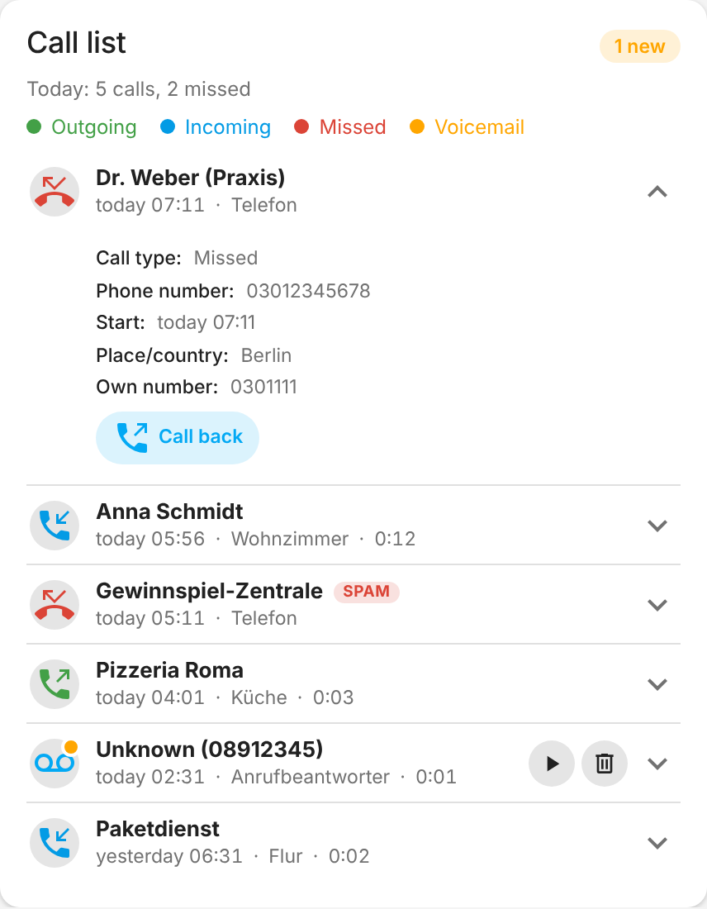
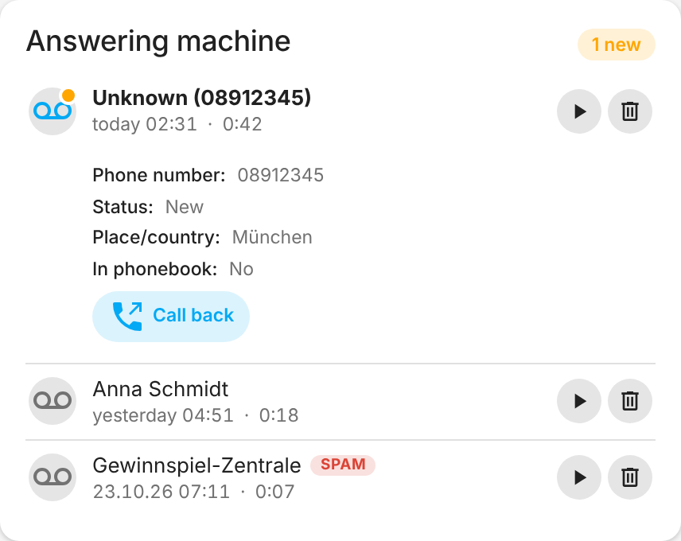
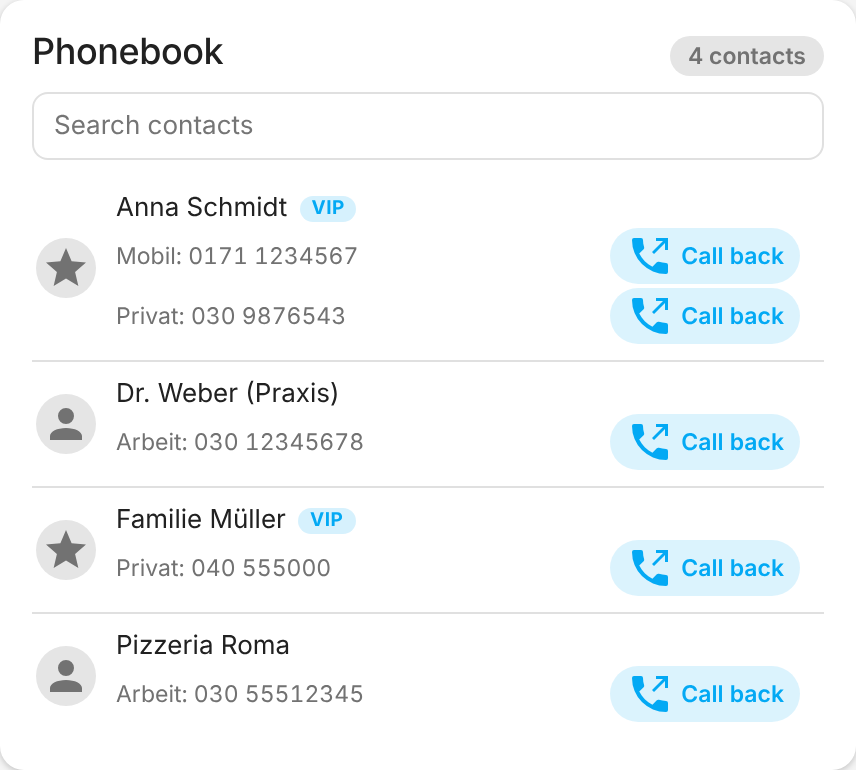
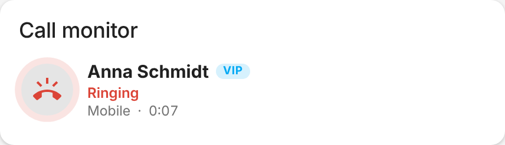
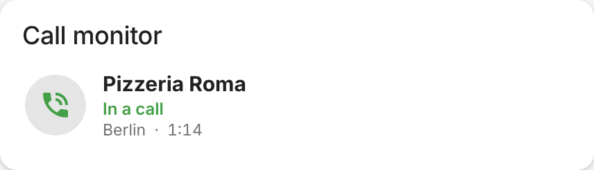
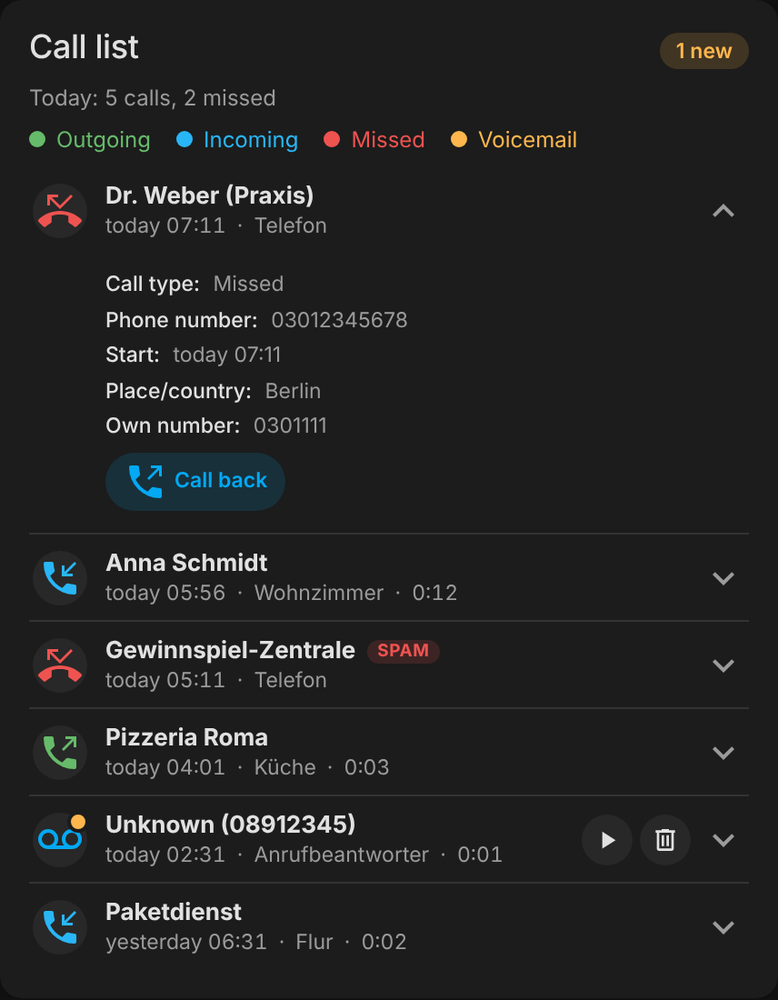
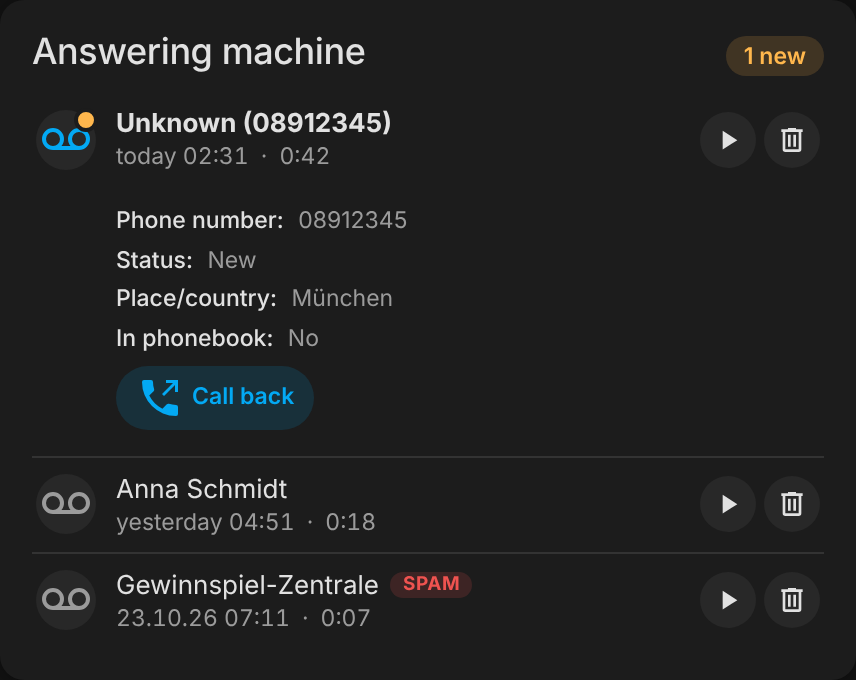

<p align="center">
  
</p>

<h1 align="center">FRITZ!Box Telefon</h1>

<p align="center">
  Phonebook, call list, answering machine and live call status of your FRITZ!Box in Home Assistant.
</p>

<p align="center">
  <a href="https://github.com/hacs/integration"></a>
  <a href="https://www.home-assistant.io/"></a>
  <a href="https://github.com/bertel2020/HA-fritzbox_phone/releases"></a>
  <a href="https://github.com/bertel2020/HA-fritzbox_phone/actions/workflows/tests.yml"></a>
  <a href="https://github.com/bertel2020/HA-fritzbox_phone/actions/workflows/hassfest.yml"></a>
  <a href="LICENSE"></a>
</p>

<p align="center">
  <a href="https://buymeacoffee.com/bertel2020"></a>
  <a href="https://ko-fi.com/bertel2020"></a>
  <a href="https://paypal.me/RobertoMartins"></a>
</p>

<p align="center"><em><a href="https://github.com/bertel2020/HA-fritzbox_phone/blob/main/README.md">Deutsche Version</a></em></p>

**FRITZ!Box Telefon** (FRITZ!Box Phone) brings the telephony of your FRITZ!Box into Home Assistant: the phonebook, the call list, the messages of the answering machine and a call monitor that reports ringing, calls and dialing in real time. It also ships a dashboard card, services for dialing and hanging up, and ready-made blueprints.

The integration talks to the FRITZ!Box locally (TR-064 and the CallMonitor on port 1012). Only the optional services PhoneBlock (spam check) and Tellows (reverse lookup) open internet connections.

> The detailed user guide is currently available in German only: [docs/USER-GUIDE.de.md](docs/USER-GUIDE.de.md). The card follows the Home Assistant language and is available in English and German.

## Screenshots

<p align="center">
  
  
</p>

| Phonebook | Call monitor |
| --- | --- |
|  | <br> |

<details>
<summary>Dark theme</summary>

<p align="center">
  
  
</p>

</details>

## Highlights

- **Call list and answering machine**: sensors and a card for all calls and voice messages. Messages can be played, marked as read and deleted right in the card; recordings are streamed by the integration behind your Home Assistant login.
- **Phonebook**: all phonebooks of the box, searchable, with VIP marking. Known callers are shown by name.
- **Live call monitor**: ringing, talking, dialing and hang-up as a sensor, event entity and logbook entry. Simultaneous calls are tracked separately. Name, spam check and reverse lookup follow after the call is shown and never delay it.
- **Spam check**: incoming numbers are checked with PhoneBlock (only hashes of the number are sent).
- **Reverse lookup**: unknown numbers are resolved through Tellows.
- **Place and country**: the origin of a number is determined offline.
- **Dial and hang up**: the services `dial` and `hangup`, plus a call-back button in the card.
- **Statistics**: calls today, missed calls and talk time as sensors.
- **Blueprints**: notification for a missed call and a warning for spam calls.
- **Easy setup**: the box is found automatically on the network; new credentials or a new address without setting up again; diagnostics to share when asking for help.

## Quick start

1. **Prepare the FRITZ!Box**: enable TR-064 (*Home Network → Network → Network Settings → “Allow access for applications”*), create a dedicated user with the “FRITZ!Box settings” permission, and for the call monitor dial `#96*5*` once on a connected phone.
2. **Install**: open the integration in HACS with the button below, download it and restart Home Assistant.

   [](https://my.home-assistant.io/redirect/hacs_repository/?owner=bertel2020&repository=HA-fritzbox_phone&category=integration)

3. **Add the integration** (not optional): *Settings → Devices & services → Add integration → FRITZ!Box Telefon*, or use the button.

   [](https://my.home-assistant.io/redirect/config_flow_start/?domain=fritzbox_phone)

4. **Add the card**: after the restart the card is available automatically. In a dashboard choose *Add card → FRITZ!Box Telefon* and select an entity of the integration.

```yaml
type: custom:fritzbox-phone-card
entity: sensor.YOUR_CALL_LIST               # the call list entity
tam_entity: sensor.YOUR_ANSWERING_MACHINE  # optional
```

**Home Assistant 2025.10 or newer** is required. Options, entities, services, blueprints and troubleshooting are covered in the [user guide](docs/USER-GUIDE.de.md) (German).

## Privacy in short

- Communication with the FRITZ!Box stays on your local network.
- PhoneBlock and Tellows are optional and can be switched off. Only SHA-1 hashes of the number go to PhoneBlock.
- Calls, phonebook and messages appear as entity attributes in Home Assistant; whoever has access there can see them.

## Changelog

See [CHANGELOG.md](CHANGELOG.md) (German).

## Disclaimer

FRITZ!Box Telefon is a privately developed, free open-source project provided without warranty. Use is at your own risk. It is an unofficial project and not affiliated with AVM, PhoneBlock or Tellows; the trademarks mentioned belong to their owners.

## License

This project is released under the [MIT License](LICENSE).
Copyright 2026 bertel2020.
