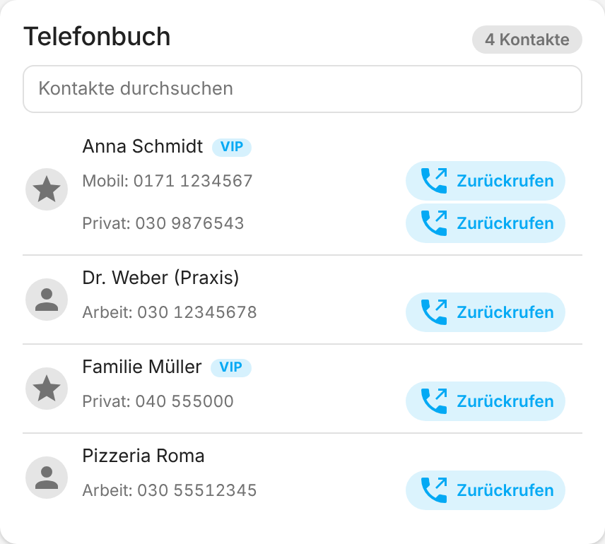
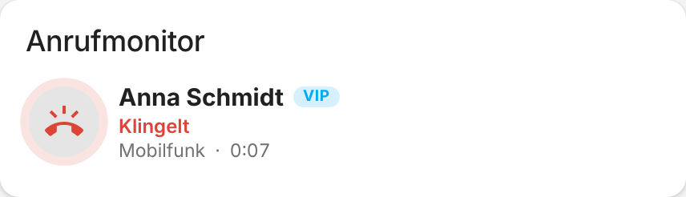
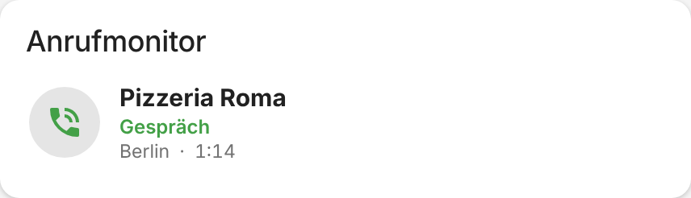
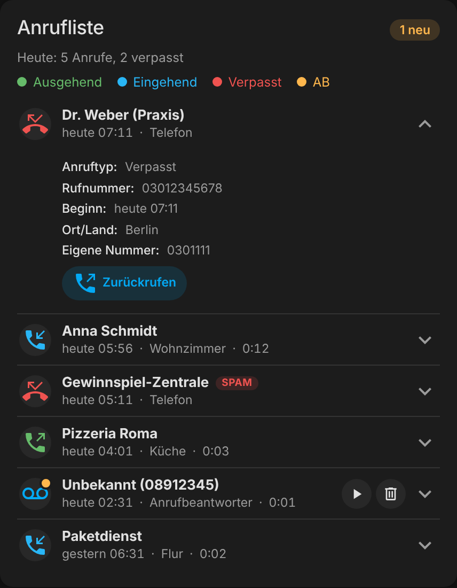
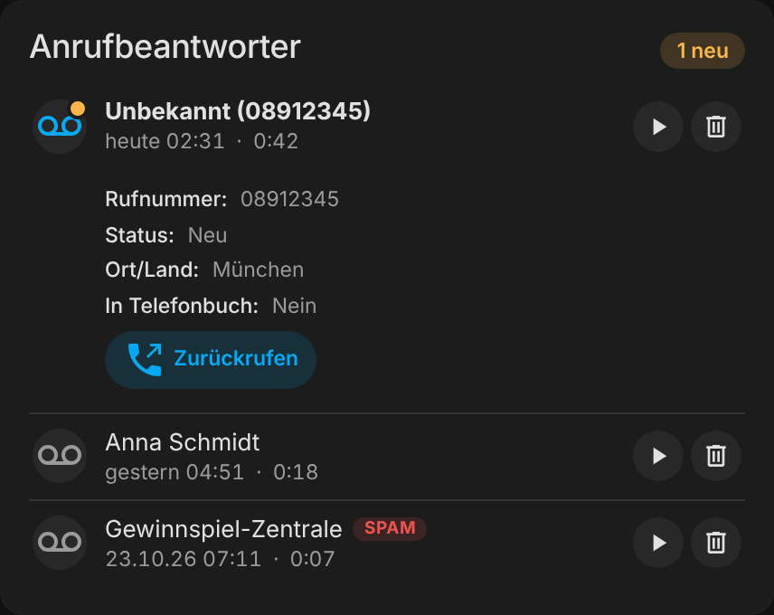

<p align="center">
  
</p>

<h1 align="center">FRITZ!Box Telefon</h1>

<p align="center">
  Telefonbuch, Anrufliste, Anrufbeantworter und Echtzeit-Anrufstatus deiner FRITZ!Box in Home Assistant.
</p>

<p align="center">
  <a href="https://github.com/hacs/integration"></a>
  <a href="https://www.home-assistant.io/"></a>
  <a href="https://github.com/bertel2020/HA-fritzbox_phone/releases"></a>
  <a href="https://github.com/bertel2020/HA-fritzbox_phone/actions/workflows/tests.yml"></a>
  <a href="https://github.com/bertel2020/HA-fritzbox_phone/actions/workflows/hassfest.yml"></a>
  <a href="LICENSE"></a>
</p>

<p align="center">
  <a href="https://buymeacoffee.com/bertel2020"></a>
  <a href="https://ko-fi.com/bertel2020"></a>
  <a href="https://paypal.me/RobertoMartins"></a>
</p>

<p align="center"><em><a href="https://github.com/bertel2020/HA-fritzbox_phone/blob/main/README.en.md">English version</a></em></p>

**FRITZ!Box Telefon** bringt die Telefonie deiner FRITZ!Box in Home Assistant: das Telefonbuch, die Anrufliste, die Nachrichten des Anrufbeantworters und einen Anrufmonitor, der Klingeln, Gespräche und Wählvorgänge in Echtzeit meldet. Dazu kommen eine eigene Dashboard-Karte, Services zum Wählen und Auflegen sowie fertige Blueprints.

Die Integration arbeitet lokal mit der FRITZ!Box (TR-064 und CallMonitor, Port 1012). Nur die optionalen Dienste PhoneBlock (Spam-Erkennung) und Tellows (Rückwärtssuche) bauen Internetverbindungen auf.

## Screenshots

<p align="center">
  
  
</p>

| Telefonbuch | Anrufmonitor |
| --- | --- |
|  | <br> |

<details>
<summary>Dunkles Design</summary>

<p align="center">
  
  
</p>

</details>

## Highlights

- **Anrufliste und Anrufbeantworter**: Sensoren und Karte für alle Anrufe und Sprachnachrichten. Nachrichten lassen sich direkt in der Karte abspielen, als gelesen markieren und löschen; die Aufnahmen werden angemeldet von der Integration gestreamt.
- **Telefonbuch**: alle Telefonbücher der FRITZ!Box, durchsuchbar, mit VIP-Markierung. Bekannte Anrufer werden mit Namen angezeigt.
- **Anrufmonitor in Echtzeit**: Klingeln, Gespräch, Wählen und Auflegen als Sensor, Ereignis-Entität und Logbuch-Eintrag. Mehrere gleichzeitige Anrufe werden einzeln verfolgt. Name, Spam-Prüfung und Rückwärtssuche folgen nach der Anzeige und blockieren sie nicht.
- **Spam-Erkennung**: Prüfung eingehender Nummern mit PhoneBlock (nur Hashes der Nummer werden gesendet).
- **Rückwärtssuche**: unbekannte Nummern werden über Tellows aufgelöst.
- **Ort und Land**: Herkunft einer Nummer wird offline bestimmt, ohne Internetzugriff.
- **Wählen und Auflegen**: Services `dial` und `hangup`, Rückruf-Knopf in der Karte.
- **Statistik**: Anrufe heute, verpasste Anrufe und Gesprächszeit als Sensoren.
- **Blueprints**: Benachrichtigung bei verpasstem Anruf und Warnung bei Spam-Anrufen.
- **Einfache Einrichtung**: automatische Erkennung der FRITZ!Box im Netzwerk, neue Anmeldung und neue Adresse ohne Neueinrichtung, Diagnosedaten zum Weitergeben.

## Schnellstart

1. **FRITZ!Box vorbereiten**: TR-064 aktivieren (*Heimnetz → Netzwerk → Netzwerkeinstellungen → „Zugriff für Anwendungen zulassen“*), einen eigenen Benutzer mit der Berechtigung „FRITZ!Box-Einstellungen“ anlegen und für den Anrufmonitor einmalig `#96*5*` an einem angeschlossenen Telefon wählen.
2. **Installieren**: Die Integration über den Button in HACS öffnen, herunterladen und Home Assistant neu starten.

   [](https://my.home-assistant.io/redirect/hacs_repository/?owner=bertel2020&repository=HA-fritzbox_phone&category=integration)

3. **Integration hinzufügen** (nicht optional): *Einstellungen → Geräte & Dienste → Integration hinzufügen → FRITZ!Box Telefon* oder über den Button.

   [](https://my.home-assistant.io/redirect/config_flow_start/?domain=fritzbox_phone)

4. **Karte einbinden**: Die Karte ist nach dem Neustart automatisch verfügbar. Im Dashboard *Karte hinzufügen → FRITZ!Box Telefon* wählen und eine Entität der Integration eintragen.

```yaml
type: custom:fritzbox-phone-card
entity: sensor.DEINE_ANRUFLISTE          # Entität der Anrufliste
tam_entity: sensor.DEIN_ANRUFBEANTWORTER   # optional
```

Voraussetzung ist **Home Assistant 2025.10 oder neuer**. Alles Weitere (Optionen, Entitäten, Services, Blueprints, Fehlerbehebung) steht in der **[Anleitung](docs/USER-GUIDE.de.md)**.

## Datenschutz in Kürze

- Die Kommunikation mit der FRITZ!Box bleibt im lokalen Netz.
- PhoneBlock und Tellows sind optional und abschaltbar. An PhoneBlock gehen nur SHA-1-Hashes der Nummer.
- Anrufe, Telefonbuch und Nachrichten stehen als Entitätsattribute in Home Assistant. Wer dort Zugriff hat, sieht sie (siehe [Datenschutz und Sicherheit](docs/USER-GUIDE.de.md#datenschutz-und-sicherheit)).

## Änderungsverlauf

Siehe [CHANGELOG.md](CHANGELOG.md).

## Haftungsausschluss

FRITZ!Box Telefon ist ein privat entwickeltes, kostenloses Open-Source-Projekt und wird ohne Gewähr bereitgestellt. Die Nutzung erfolgt auf eigene Gefahr. Die Integration ist ein inoffizielles Projekt und steht in keiner Verbindung zu AVM, PhoneBlock oder Tellows; die genannten Marken gehören ihren Inhabern (siehe [Markenhinweis](docs/USER-GUIDE.de.md#markenhinweis)).

## Lizenz

Dieses Projekt steht unter der [MIT-Lizenz](LICENSE).
Copyright 2026 bertel2020.
