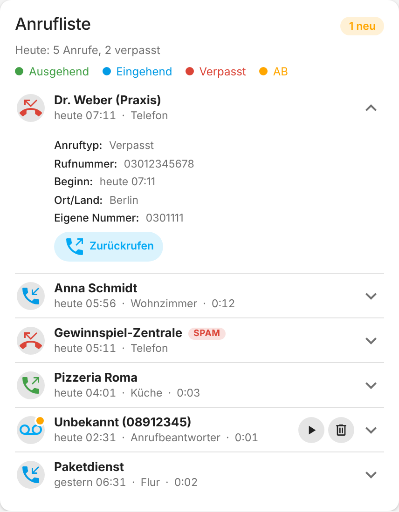
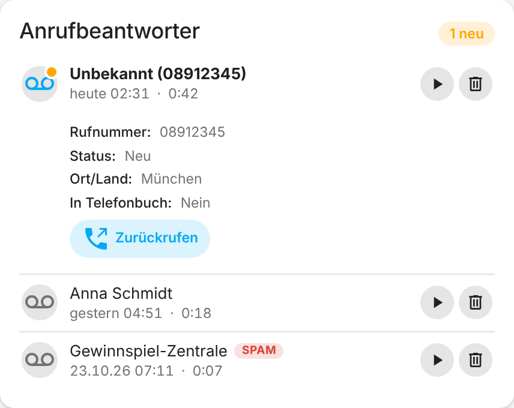

# FRITZ!Box Telefon für Home Assistant – Anleitung

[← Zurück zur Übersicht](../README.md)

Benutzerdefinierte Home-Assistant-Integration für **Telefonbuch**, **Anrufliste**,
**Anrufbeantworter** und **Echtzeit-Anrufstatus** einer FRITZ!Box – über
TR-064 (`X_AVM-DE_OnTel`, `X_AVM-DE_TAM`) und das CallMonitor-Protokoll
(Port 1012).

Die Integration arbeitet lokal mit der FRITZ!Box. Nur die optionalen
Dienste PhoneBlock und Tellows bauen Internetverbindungen auf. Technische
Grundlage sind die [AVM-Schnittstellenbeschreibungen](https://fritz.com/pages/schnittstellen)
für TR-064 (`X_AVM-DE_OnTel`, `X_AVM-DE_TAM`, `X_VoIP`).

Aktuelle Integrationsversion: **2.0.3** (siehe
[`manifest.json`](../custom_components/fritzbox_phone/manifest.json) und den
[Änderungsverlauf](../CHANGELOG.md)).

## Inhalt

- [Voraussetzungen auf der FRITZ!Box](#voraussetzungen-auf-der-fritzbox)
- [Installation](#installation)
- [Update](#update)
- [Optionen](#optionen)
- [Spam-Erkennung (PhoneBlock)](#spam-erkennung-phoneblock)
- [Rückwärtssuche (Tellows)](#rückwärtssuche-tellows)
- [Orts-/Länderkennung (offline)](#orts-länderkennung-offline)
- [Entitäten](#entitäten)
- [Logbuch und Ereignisse](#logbuch-und-ereignisse)
- [Aktionen (Services)](#aktionen-services)
- [Blueprints](#blueprints)
- [Dashboard-Karte: fritzbox-phone-card](#dashboard-karte-fritzbox-phone-card)
- [Datenschutz und Sicherheit](#datenschutz-und-sicherheit)
- [Dateien](#dateien)
- [Entwicklung und Tests](#entwicklung-und-tests)
- [Markenhinweis](#markenhinweis)
- [Hinweise](#hinweise)
- [Fehlerbehebung](#fehlerbehebung)
- [Änderungsverlauf](../CHANGELOG.md)

## Voraussetzungen auf der FRITZ!Box

| # | Was | Wo |
|---|-----|----|
| 1 | TR-064 aktivieren | Heimnetz → Netzwerk → Netzwerkeinstellungen → „Zugriff für Anwendungen zulassen" |
| 2 | Eigener FRITZ!Box-Benutzer für Home Assistant | System → FRITZ!Box-Benutzer → Berechtigung „FRITZ!Box-Einstellungen" (enthält den Zugriff auf Telefonie, Anrufliste und Sprachnachrichten) |
| 3 | Mindestens ein eingerichteter Anrufbeantworter (nur für TAM-Sensoren nötig) | Telefonie → Anrufbeantworter |
| 4 | CallMonitor aktivieren (nur für den Anrufmonitor-Sensor nötig) | einmalig `#96*5*` von einem angeschlossenen Telefon wählen (`#96*4*` deaktiviert wieder) |

## Installation

### Über HACS (empfohlen)

[](https://my.home-assistant.io/redirect/hacs_repository/?owner=bertel2020&repository=HA-fritzbox_phone&category=integration)
[](https://my.home-assistant.io/redirect/config_flow_start/?domain=fritzbox_phone)

1. Über den ersten Button das FRITZ!Box-Telefon-Repository in HACS öffnen.
2. **FRITZ!Box Telefon** herunterladen und Home Assistant neu starten.
3. Über den zweiten Button die Integration hinzufügen. Alternativ in Home
   Assistant **Einstellungen → Geräte & Dienste → Integration hinzufügen →
   FRITZ!Box Telefon** öffnen.
4. Host/IP, Benutzername und Kennwort eingeben (eine im Netzwerk
   gefundene FRITZ!Box schlägt Home Assistant automatisch vor - dann genügen
   Benutzername und Kennwort). TLS ist optional; der Port
   wird automatisch anhand der TLS-Einstellung gewählt, kann aber
   überschrieben werden.

Falls der erste Button nicht funktioniert, in HACS unter **Integrationen →
Benutzerdefinierte Repositories** `https://github.com/bertel2020/HA-fritzbox_phone`
als Kategorie **Integration** eintragen. Voraussetzung ist in beiden Fällen eine
eingerichtete [HACS-Installation](https://www.hacs.xyz/).

### Manuell

Den Ordner `custom_components/fritzbox_phone` aus dem Repository manuell nach
`<HA-Konfigurationsverzeichnis>/custom_components/fritzbox_phone/` kopieren.
Im Home-Assistant-Konfigurationsverzeichnis muss anschließend diese Struktur
vorliegen:

```text
<HA-Konfigurationsverzeichnis>/
└── custom_components/
    └── fritzbox_phone/
        ├── manifest.json
        ├── __init__.py
        ├── sensor.py
        └── ...
```

Der Zielordner muss exakt `fritzbox_phone` heißen und `manifest.json` muss
direkt darin liegen. Anschließend Home Assistant neu starten und die
Integration über den zweiten Button oben oder unter **Einstellungen → Geräte &
Dienste → Integration hinzufügen → FRITZ!Box Telefon** einrichten.

Beim ersten Start installiert Home Assistant die in `manifest.json`
aufgeführten Python-Abhängigkeiten automatisch. Dafür kann einmalig ein
Internetzugang des Home-Assistant-Systems erforderlich sein.

## Update

Bei einer HACS-Installation werden verfügbare Aktualisierungen in HACS
angezeigt und von dort installiert. Bei einer manuellen Installation den
Inhalt von `custom_components/fritzbox_phone/` vollständig durch den Inhalt
der neuen Version ersetzen. Die Konfiguration liegt in Home Assistant und
geht dadurch nicht verloren.

Anschließend Home Assistant neu starten. Falls sich die Dashboard-Karte
geändert hat: Browser neu laden (die Karte wird mit der Version der
Integration im Adresspfad geladen, ein Update holt also automatisch die
neue Datei).

## Optionen

Über **Einstellungen → Geräte & Dienste → FRITZ!Box Telefon →
Konfigurieren** nachträglich änderbar. Host, Port, TLS und Zugangsdaten der
Box ändert **Neu konfigurieren** im Menü des Eintrags; lehnt die Box die
gespeicherten Zugangsdaten ab, fragt Home Assistant selbst nach neuen
(Reauth):

| Option | Standard | Bedeutung |
|--------|----------|-----------|
| Abfrageintervall | 120 s | Polling-Takt für Telefonbuch/Anrufliste/Anrufbeantworter |
| Anruflisten-Zeitraum | 7 Tage | wie weit `sensor.*_anrufliste` zurückschaut |
| Maximale Anzahl Anrufe | 50 | Obergrenze der geladenen Anrufliste |
| Anrufmonitor aktivieren | an | schaltet `sensor.*_anrufmonitor` komplett ab/an |
| Anrufmonitor-Port | 1012 | CallMonitor-Port |
| Vorwahl-Präfixe | leer | kommagetrennt, z. B. `+49`; überschreibt das Land aus der Home-Assistant-Konfiguration. Ohne Eintrag gilt das dort eingestellte Land. Rufnummern werden für den Telefonbuchabgleich, PhoneBlock und Tellows einheitlich auf E.164 (`+4930123456`) gebracht - egal, ob die Box sie national, international oder (aus dem eigenen Ortsnetz) ohne Vorwahl meldet |
| PhoneBlock aktivieren | aus | schaltet die Spam-Erkennung an/aus, siehe unten |
| PhoneBlock-Benutzername / -Kennwort | leer | Zugangsdaten eines kostenlosen Accounts auf [phoneblock.net](https://phoneblock.net). Das gespeicherte Kennwort wird nie wieder ins Formular geladen - ein leeres Feld lässt es unverändert |
| Spam-Schwellwert | 50 % | ab welcher PhoneBlock-Spam-Wahrscheinlichkeit `is_spam` gesetzt wird |
| Online-Rückwärtssuche (Tellows) aktivieren | aus | schaltet die Namensauflösung unbekannter Nummern über Tellows an/aus, siehe unten |

## Spam-Erkennung (PhoneBlock)

Optionale, standardmäßig deaktivierte Anreicherung unbekannter Anrufer mit
einer Spam-Einschätzung von [PhoneBlock](https://phoneblock.net) (kostenlos,
Open Source, community-gepflegte Spam-Nummern-Datenbank, extra für
FRITZ!Box-Anwendungsfälle gebaut).

**Datenschutz:** Es wird **nicht die Rufnummer selbst** an PhoneBlock
geschickt. Die Integration normalisiert sie nach Möglichkeit auf E.164 und
sendet an `GET /api/check` den SHA-1-Hash der vollständigen Nummer sowie zwei
weitere SHA-1-Hashes, bei denen die letzte bzw. die letzten beiden Ziffern
fehlen (`prefix10` und `prefix100`). Diese zusätzlichen Hashes ermöglichen
PhoneBlock die Erkennung von Nummernbereichen. Angefragt wird nur bei
Anrufen/Nachrichten, die die FRITZ!Box selbst keinem
Telefonbuch-Kontakt zuordnen konnte; Ergebnisse werden 6 Stunden lang lokal
zwischengespeichert, um nicht bei jedem Abfragezyklus erneut nachzufragen;
ein Fehlschlag (Timeout, Ausfall) wird nur 5 Minuten gemerkt. Mehrere
unbekannte Nummern werden parallel abgefragt, ein Abfragezyklus wartet dabei
höchstens 20 Sekunden (beim Start 5) - was dann noch aussteht, landet im
Hintergrund im Zwischenspeicher.

**Einrichten:**
1. Kostenlosen Account auf [phoneblock.net](https://phoneblock.net) anlegen.
2. Einstellungen → Geräte & Dienste → FRITZ!Box Telefon → Konfigurieren →
   „PhoneBlock-Spamerkennung aktivieren" + Benutzername/Kennwort eintragen.

**Was wird angereichert:** `sensor.*_anrufliste` (Einträge ohne
Telefonbuch-Namen), `sensor.*_<anrufbeantworter>` (Nachrichten ohne
Telefonbuch-Namen) sowie `sensor.*_anrufmonitor` bei eingehenden Anrufen
unbekannter Nummern – jeweils um `is_spam`, `spam_confidence` (0–100),
`spam_rating` (PhoneBlock-Einstufung wie `E_ADVERTISING`) und
`spam_location` (Ort, falls bekannt). Die `fritzbox-phone-card` zeigt dafür
automatisch ein rotes „Spam"-Badge neben dem Namen an.

Diese API liefert **keinen Namen** zu einer Nummer (nur Spam-Bewertung) –
für eine echte Namensauflösung siehe [Rückwärtssuche (Tellows)](#rückwärtssuche-tellows).

## Rückwärtssuche (Tellows)

Optionale, standardmäßig deaktivierte Namensauflösung unbekannter Anrufer
über [Tellows](https://www.tellows.de) – eine öffentliche, community-
gepflegte Anrufer-/Spam-Datenbank. Die Integration verwendet dafür den
ohne Account erreichbaren Endpunkt `GET /basic/num/{nummer}?xml=1`.

**Datenschutz:** Anders als bei der PhoneBlock-Spam-Erkennung wird hier die
**Rufnummer im Klartext** an Tellows geschickt – das ist der Zweck der
Rückwärtssuche und lässt sich technisch nicht vermeiden. Deshalb ist diese
Option bewusst **getrennt** von der PhoneBlock-Option und standardmäßig
deaktiviert. Angefragt wird nur bei Anrufen/Nachrichten ohne
Telefonbuch-Namen; Ergebnisse werden 6 Stunden lokal zwischengespeichert (Fehlschläge 5
Minuten). Die Antwort wird mit `defusedxml` ausgewertet und auf 64 KB
begrenzt.

**Einrichten:** Einstellungen → Geräte & Dienste → FRITZ!Box Telefon →
Konfigurieren → „Online-Rückwärtssuche (Tellows) aktivieren". Kein Account
nötig.

**Was wird angereichert:** `sensor.*_anrufliste`, `sensor.*_<anrufbeantworter>`
und `sensor.*_anrufmonitor` (bei unbekannten eingehenden Anrufen) um
`reverse_name` und `reverse_category` (z. B. „Bestattungen", falls Tellows
das weiß). Die `fritzbox-phone-card` zeigt `reverse_name` direkt als Namen
an (statt „Unbekannt"), mit Quellenangabe „Tellows (Online-Rückwärtssuche)"
in den aufklappbaren Details, sobald kein Telefonbuch-Name vorliegt.

## Orts-/Länderkennung (offline)

Zusätzlich zur Namensauflösung kann jeder Anruf/jede Nachricht (in den
aufklappbaren Details der `fritzbox-phone-card`, Feld „Ort/Land") eine
Ortsangabe wie „Berlin" oder „Köln" bzw. bei internationalen Nummern das
Land. Das läuft **immer** und ganz ohne FritzBox- oder Internet-Abfrage:

TR-064 bietet dafür keine direkte Abfrage für beliebige Rufnummern –
geprüft wurde das gegen die Spezifikationen von `X_AVM-DE_OnTel` und
`X_AVM-DE_TAM`. Stattdessen nutzt die Integration
[`phonenumbers`](https://pypi.org/project/phonenumbers/) (die Python-Portierung
von Googles libphonenumber), die eine eigene Vorwahl-Datenbank mitbringt –
exakt die Art von Zuordnung, die auch die FritzBox-Weboberfläche selbst
lokal berechnet. Rein lokale Berechnung, keine Rufnummer verlässt den
Rechner. Für deutsche Mobilfunknummern liefert das nur "Deutschland"
(Mobilfunk-Vorwahlen sind nicht regional gebunden); für Festnetznummern
die Stadt/Region.

**Anrufe aus dem eigenen Ortsnetz:** Die FRITZ!Box meldet Rufnummern aus
ihrem eigenen lokalen Vorwahlbereich ohne jede Vorwahl (z. B. „954934"
statt „07527954934") – ohne Korrektur würde `phonenumbers` das falsch
oder unplausibel deuten (z. B. einen völlig falschen Ort raten). Die
Integration fragt dafür einmalig (und dann dauerhaft zwischengespeichert)
die eigene Vorwahl der Box über TR-064 ab (`X_VoIP` /
`X_AVM-DE_GetVoIPCommonAreaCode`) und ergänzt sie automatisch, wenn eine
Rufnummer ohne führende „0" bzw. „+" ankommt.

## Entitäten

Alle Entitäten hängen an einem Gerät pro FRITZ!Box (mit Modell, Seriennummer
und Firmware). Namen und Symbole sind übersetzt (Deutsch/Englisch).

| Entität | Zustand | Wichtigste Attribute |
|---------|---------|----------------------|
| `sensor.*_<telefonbuch>` (je Telefonbuch) | Anzahl Kontakte | `contacts`: Name, Rufnummern inkl. Typ, VIP-Flag, `has_image` |
| `sensor.*_anrufliste` | Anzahl geladener Anrufe | `calls`: Typ, Name, Nummern, Datum, Dauer, Gerät/Port, Fax-/Anrufbeantworter-Flag, `has_recording`, `tam_index`/`tam_message_index` (zu welcher AB-Nachricht der Anruf gehört), `area_name` (Ort/Land, offline), PhoneBlock-Spamfelder, `reverse_name`/`reverse_category` (Tellows, jeweils falls aktiviert) |
| `sensor.*_verpasste_anrufe` | Anzahl verpasster Anrufe | `calls`: nur verpasste Anrufe |
| `sensor.*_anrufe_heute` | Anrufe von heute | `incoming`, `outgoing`, `missed` |
| `sensor.*_gespraechszeit_heute` | Minuten in angenommenen Gesprächen von heute | - (die Box rundet jeden Anruf auf die Minute auf) |
| `sensor.*_<anrufbeantworter>` (je TAM) | Anzahl neuer Nachrichten | `tam_index`, `messages`: Anrufer, Datum, Dauer, gelesen/neu, `has_recording`, `recording_path`, `area_name` (Ort/Land, offline), PhoneBlock-Spamfelder, `reverse_name`/`reverse_category` (Tellows, jeweils falls aktiviert) |
| `switch.*_<anrufbeantworter>_aktiv` | an/aus | – |
| `binary_sensor.*_ungelesene_nachrichten` | an, solange irgendein Anrufbeantworter ungehörte Nachrichten hat | `count` |
| `sensor.*_anrufmonitor` | `idle` / `ringing` / `dialing` / `talking`; `unavailable`, solange die Verbindung zum CallMonitor nicht steht | je nach Zustand `from`/`to`/`with`, `from_name`/`to_name`/`with_name`, `vip`, `area_name` (Ort/Land, offline), `device`, `duration`, bei unbekannten eingehenden Anrufen zusätzlich PhoneBlock-Spamfelder und `reverse_name`/`reverse_category` (Tellows, jeweils falls aktiviert); im Zustand `idle` bleiben die Felder des zuletzt beendeten Gesprächs erhalten, ergänzt um `initiated` (Klingel-/Wählbeginn), `accepted` (Annahmezeitpunkt), `started` (Gesprächsbeginn = `accepted`, falls vorhanden), `closed` (Auflegen), `duration_formatted` (exakte Gesprächsdauer inkl. Sekunden, z. B. `1:09:18`) und `ring_duration_formatted` (Klingeldauer bis zur Annahme, z. B. `0:11`, nur falls der Anruf angenommen wurde) |
| `binary_sensor.*_klingelt` | an, solange ein Anruf klingelt | `number`, `name`, `is_spam` |
| `event.*_anruf` | letzter Anruf-Vorgang | Ereignistyp `ringing` / `dialing` / `talking` / `ended` / `updated`; Attribute wie das Ereignis `fritzbox_phone_call` |

Neue Telefonbücher und Anrufbeantworter erscheinen automatisch (ein
Telefonbuch spätestens nach 15 Minuten, siehe unten); verschwindet eines,
bleibt die Entität als „nicht verfügbar" stehen und kann in der
Oberfläche gelöscht werden.

Die Listen-Attribute (`calls`, `contacts`, `messages`) werden **nicht in der
Datenbank (Recorder) gespeichert** - sie würden dessen Größenlimit pro Zustand
sprengen. Den Verlauf liefern die Logbuch-Ereignisse. Das Telefonbuch wird nur
alle 15 Minuten neu von der Box geladen, Anrufliste und Anrufbeantworter bei
jedem Abfragezyklus.

Der Anrufmonitor hält eine dauerhafte Socket-Verbindung zum
CallMonitor (Port 1012) und aktualisiert sich unabhängig vom
Abfrageintervall der anderen Sensoren in Echtzeit – Zustände und
Attributschema entsprechen dem Core-Sensor `fritzbox_callmonitor`, nutzt
aber die bereits konfigurierten Zugangsdaten und Telefonbücher dieser
Integration statt eines eigenen Config-Eintrags.

**Klingeln erscheint sofort.** Der Zustand `ringing` wird gesetzt, sobald
die Box den Anruf meldet; Spam-Prüfung und Rückwärtssuche laufen danach und
kommen als zweites Ereignis (`enriched: true`, im Logbuch „Anrufer näher
bestimmt") nach. Mehrere gleichzeitige Gespräche (Anklopfen) werden getrennt
verfolgt: angezeigt wird das wichtigste laufende (Gespräch vor Klingeln vor
Wählen), nach dem Auflegen eines Gesprächs bleibt ein noch klingelnder
Anruf sichtbar. Verweigert die Box die Verbindung (CallMonitor nicht
aktiviert, Neustart), versucht die Integration es mit wachsendem Abstand
erneut (30 s bis 5 min), statt aufzugeben.

## Logbuch und Ereignisse

Home Assistant zeigt im Aktivitätsdialog einer Entität unter **„Was ist
passiert“** den Grund einer Zustandsänderung an. Damit dort nicht „Für diese
Aktivität wurde kein Grund festgehalten“ steht, feuert die Integration zu
jeder nennenswerten Änderung ein Ereignis und schreibt den neuen Zustand im
selben Kontext – das Logbuch macht daraus deutschen Klartext:

| Entität | Beispiel für „Was ist passiert“ |
|---------|--------------------------------|
| `sensor.*_anrufmonitor` | Eingehender Anruf von Max Mustermann (+49301234567) |
| | Ausgehender Anruf an Max Mustermann (+49301234567) über DECT1 |
| | Gespräch mit Max Mustermann (+49301234567) angenommen (nach 0:12 Klingeln) |
| | Gespräch mit Max Mustermann (+49301234567) beendet nach 2:31 |
| | Anruf von +49309999999 (Berlin) nicht angenommen – als Spam eingestuft (Vertrauen 95 %) |
| `sensor.*_anrufliste` | Neuer Eintrag: Ausgehender Anruf an Max Mustermann (+49301234567) |
| | 2 Einträge nicht mehr in der Anrufliste (außerhalb des Zeitfensters oder auf der FRITZ!Box gelöscht) |
| `sensor.*_verpasste_anrufe` | Verpasster Anruf von +49309999999 (Berlin) um 16:10 |
| `sensor.*_<anrufbeantworter>` | Neue Nachricht von Max Mustermann (+49301234567), Dauer 0:42 |

Die Ereignisse lassen sich auch direkt als Automations-Auslöser verwenden:

| Ereignis | Wann | Nutzbare Felder |
|----------|------|-----------------|
| `fritzbox_phone_call` | jede Änderung des Anrufmonitors; zusätzlich ein Folge-Ereignis, wenn Spam-Prüfung/Rückwärtssuche erst später ein Ergebnis liefern | `call_state` (`ringing`/`dialing`/`talking`/`idle`), `direction`, `number`, `name`, `reverse_name`, `device`, `vip`, `is_spam`, `spam_confidence`, `answered`, `duration_formatted`, `ring_duration_formatted`, `enriched` (`true` beim Folge-Ereignis) |
| `fritzbox_phone_call_list_changed` | neue oder entfallene Einträge der Anrufliste | `added` (Liste), `added_count`, `removed` |
| `fritzbox_phone_missed_call` | neue oder entfallene verpasste Anrufe | `added` (Liste), `added_count`, `removed` |
| `fritzbox_phone_tam_message` | neue oder gelesene/gelöschte AB-Nachrichten | `tam_index`, `tam_name`, `added` (Liste), `added_count`, `removed` |

Für Automationen im Editor eignen sich auch die Entitäten `event.*_anruf` und `binary_sensor.*_klingelt`. Jedes Ereignis enthält zusätzlich `config_entry_id` und `host`, um bei mehreren
FRITZ!Boxen filtern zu können. Beispiel:

```yaml
triggers:
  - trigger: event
    event_type: fritzbox_phone_call
    event_data:
      call_state: ringing
      is_spam: true
actions:
  - action: notify.persistent_notification
    data:
      message: "Spam-Anruf von {{ trigger.event.data.number }}"
```

> Die Ereignisse tragen bewusst **keine** `entity_id`: Home Assistant würde sie
> sonst zusätzlich als eigene Zeile in der Aktivitätsliste der Entität führen –
> also doppelt zu der Zustandsänderung, die sie ohnehin schon erklären.

## Aktionen (Services)

| Aktion | Zweck | Ziel / Felder |
|---------|-------|--------|
| `fritzbox_phone.mark_message_read` | Anrufbeantworter-Nachricht als (un)gelesen markieren | `sensor.*_<anrufbeantworter>`; `message_index`, `read` |
| `fritzbox_phone.delete_message` | Nachricht auf der Box löschen | `sensor.*_<anrufbeantworter>`; `message_index` |
| `fritzbox_phone.download_message` | **Veraltet.** Sprachnachricht nach `config/www/fritzbox_tam/<Dateiname>` speichern. Die Datei ist danach **ohne Anmeldung** unter `/local/...` abrufbar; erlaubt sind nur Dateinamen mit Endung `.wav`, `.mp3` oder `.ogg` | `sensor.*_<anrufbeantworter>`; `message_index`, `filename` |
| `fritzbox_phone.dial` | Anruf über die Wählhilfe der Box starten: das dort gewählte Telefon klingelt zuerst, die Nummer wird nach dem Abheben gewählt | Gerät (bei nur einer Box optional); `number` |
| `fritzbox_phone.hangup` | Einen noch nicht angenommenen Wählvorgang abbrechen | Gerät (optional) |
| `fritzbox_phone.lookup_number` | Antwortet mit dem, was zu einer Nummer bekannt ist | Gerät (optional); `number` |

Die Wählhilfe muss an der FRITZ!Box aktiviert sein (Telefonie →
Telefoniegeräte). `dial` nimmt nur Ziffern und die Zeichen `+ * # ( ) - /`
sowie Leerzeichen an.

`message_index` steht als `index` im Attribut `messages` des jeweiligen
Sensors. Auf einer anderen Entität aufgerufen, antworten die Aktionen für den
Anrufbeantworter mit einer Fehlermeldung. Beispiele:

```yaml
action: fritzbox_phone.mark_message_read
target:
  entity_id: sensor.DEIN_ANRUFBEANTWORTER
data:
  message_index: 3
  read: true
```

```yaml
# Rückruf aus einer Automation
action: fritzbox_phone.dial
data:
  number: "030 123456"
```

```yaml
# Was weiß die Integration über diese Nummer?
action: fritzbox_phone.lookup_number
data:
  number: "+49 30 123456"
response_variable: info
# info.contact.name, info.area_name, info.spam.confidence, info.reverse_lookup.name
```

`delete_message` löscht die gewählte Nachricht auf der FRITZ!Box. Vor dem
Einsatz in Automationen sollte deshalb geprüft werden, ob die Zielentität und
der Nachrichtenindex wirklich passen.

## Dashboard-Karte: fritzbox-phone-card

<p align="center">
  
  
</p>

Die Integration bringt eine eigene, native Lovelace-Karte als JS-Ressource
mit (`www/fritzbox-phone-card.js`, wird beim Setup automatisch unter
`/fritzbox_phone_static/fritzbox-phone-card.js` bereitgestellt). Sie
erkennt anhand der Entität automatisch, ob es sich um eine Anrufliste
(`calls`-Attribut), einen Anrufbeantworter (`messages`-Attribut) oder den
Anrufmonitor (Zustand `idle`/`ringing`/`dialing`/`talking`) handelt, und
rendert die passende Ansicht. Anrufliste und Anrufbeantworter teilen sich
dabei denselben Zeilenaufbau (Icon | Name + Datum [· Endgerät nur bei der
Anrufliste] · Dauer | ggf. Abspielen/Löschen). Bei unbekannten Anrufern
erscheint die Rufnummer in Klammern hinter „Unbekannt" (z. B. „Unbekannt
(030123456)"); ist ein Name bekannt, steht die Rufnummer nur noch in den
aufklappbaren Details einer Zeile. Aufnahmen spielt die Karte **angemeldet** ab: Die Integration streamt sie
über `/api/fritzbox_phone/recording/...` direkt von der Box (die
Sitzungskennung der Box verlässt die Integration nie), die Karte holt dafür
von Home Assistant eine kurzlebige signierte Adresse. Während einer Wiedergabe
bleiben aufgeklappte Zeilen, Legendenfilter und eine offene Löschabfrage
erhalten - auch wenn Home Assistant neue Zustände liefert.

**Aktiver Anruf:** Zeigt die Karte auf `sensor.*_anrufmonitor`, rendert sie
statt einer Liste eine einzelne, groß hervorgehobene Zeile mit dem aktuell
laufenden Anruf – Name/Nummer (inkl. VIP- und Spam-Badge, Tellows-Name bei
unbekannten Anrufern), Zustand („Klingelt"/„Wählt"/„Gespräch", farblich
abgesetzt, Icon pulsiert bei „Klingelt") sowie Ort/Land und eine laufende
Zeit seit Klingeln/Wählen/Gesprächsbeginn (aktualisiert sich selbst jede
Sekunde, unabhängig vom Abfrageintervall, da der Anrufmonitor Ereignisse
in Echtzeit über die eigene CallMonitor-Verbindung erhält). Ist kein Anruf
aktiv, steht dort „Kein aktiver Anruf" plus – falls vorhanden – eine Zeile
zum zuletzt beendeten Gespräch: Name/Nummer, Beginn–Ende (z. B.
„16:17–17:26"), Ort/Land und die exakte Gesprächsdauer inkl. Sekunden
(z. B. „1:09:18" statt der auf Minuten gerundeten Dauer aus der
Anrufliste).

**Anrufbeantworter in die Anrufliste integrieren:** Über die optionale
Option `tam_entity` lässt sich ein Anrufbeantworter-Sensor mit der
Anrufliste verknüpfen – **nicht** als zusätzliche Liste, sondern direkt in
der jeweiligen Zeile: Ein Anruf, der auf den Anrufbeantworter ging,
bekommt zusätzlich zum Aufklapp-Pfeil Play-/Löschen-Buttons (inkl.
Fortschrittsbalken beim Abspielen), ein Voicemail-Icon und einen
„Neu"-Punkt bei ungehörten Nachrichten – die zwei Ereignisse (Anruf und
Anrufbeantworter-Nachricht) verschmelzen so zu einer einzigen Zeile, ohne
die Aufklapp-Details zu verlieren. Die Legende bekommt dafür einen
zusätzlichen Filter „AB“ (eigene Kategorie, analog zu „Verpasst“), und der
Kartenkopf zeigt dieselbe „X neu“-Pille wie die eigenständige
Anrufbeantworter-Karte (zählt alle neuen Nachrichten der verknüpften
Entität, nicht nur die in der Anrufliste sichtbaren).

Die Zuordnung erfolgt bevorzugt über die Aufnahmedatei, auf die Anruf und
Nachricht beide zeigen (`tam_message_index` im Anruf). Fehlt sie, fällt die
Karte auf die Rufnummer zurück (toleriert nationale/internationale
Schreibweisen wie `030123456` vs. `+4930123456`) und, falls mehrere
Nachrichten derselben Nummer infrage kommen, den zeitlich nächstliegenden
Zeitstempel. Nachrichten ohne
passenden Eintrag in der (zeitlich/mengenmäßig begrenzten) Anrufliste
erscheinen hier nicht – dafür bleibt die eigenständige
Anrufbeantworter-Karte (`entity` direkt auf den Anrufbeantworter-Sensor
gesetzt, ohne `tam_entity`) weiterhin vollständig nutzbar, inkl. aller
Nachrichten unabhängig vom Anrufliste-Zeitraum.

**Keine Einrichtung nötig:** Die Integration meldet die Karte beim Start selbst
bei Home Assistant an (auch für YAML-Dashboards). Eine früher von Hand
eingetragene Ressource (`/fritzbox_phone_static/fritzbox-phone-card.js`,
Typ `module`) kann bestehen bleiben oder entfernt werden.

Die Karte über **„Karte hinzufügen" → „FRITZ!Box Anrufliste /
Anrufbeantworter / Telefonbuch / Anrufmonitor"** mit grafischem Editor
hinzufügen (er zeigt nur die Optionen, die zur gewählten Entität passen), oder
direkt per YAML:

```yaml
type: custom:fritzbox-phone-card
entity: sensor.DEINE_FRITZBOX_ANRUFLISTE
rows: 8
```

```yaml
# Anrufliste + Anrufbeantworter in einer Karte
type: custom:fritzbox-phone-card
entity: sensor.DEINE_FRITZBOX_ANRUFLISTE
tam_entity: sensor.DEIN_ANRUFBEANTWORTER
rows: 8
```

```yaml
type: custom:fritzbox-phone-card
entity: sensor.DEIN_ANRUFBEANTWORTER
rows: 8
mark_read_on_play: true
```

```yaml
type: custom:fritzbox-phone-card
entity: sensor.DEIN_ANRUFMONITOR
```

```yaml
# Telefonbuch mit Suche
type: custom:fritzbox-phone-card
entity: sensor.DEIN_TELEFONBUCH
rows: 10
```

Die Karte folgt der Sprache von Home Assistant (Deutsch oder Englisch), lässt
sich per Tastatur bedienen (Enter/Leertaste klappt Zeilen auf) und meldet
Fehler als Home-Assistant-Hinweis statt als Dialog.

| Option | Standard | Bedeutung |
|--------|----------|-----------|
| `entity` | – (Pflichtfeld) | `sensor.*_anrufliste`, `sensor.*_<anrufbeantworter>`, `sensor.*_<telefonbuch>` oder `sensor.*_anrufmonitor` |
| `title` | Name der Entität | Kartentitel überschreiben |
| `rows` | 8 | Anrufliste/Anrufbeantworter/Telefonbuch: maximale Anzahl angezeigter Zeilen |
| `show_legend` | an | Nur Anrufliste: farbige Legende (Ausgehend/Eingehend/Verpasst) über der Liste |
| `tam_entity` | – (optional) | Nur Anrufliste: verknüpfter `sensor.*_<anrufbeantworter>` - Anrufe, die dorthin gingen, bekommen Play/Löschen direkt in ihrer Zeile |
| `show_stats` | an | Nur Anrufliste: Zeile „Heute: x Anrufe, y verpasst" |
| `show_dial` | an | Anrufliste, Anrufbeantworter, Telefonbuch: „Zurückrufen"-Knöpfe (über `fritzbox_phone.dial`) |
| `tap_action` | `expand` | Anrufliste/Anrufbeantworter: Antippen einer Zeile klappt Details auf (`expand`) oder öffnet die Entität (`more-info`) |
| `mark_read_on_play` | an | Nur Anrufbeantworter (auch als `tam_entity`): Nachricht beim Abspielen automatisch als gelesen markieren |

Die Legende ist klickbar: ein Klick auf einen Eintrag blendet alle Anrufe
dieses Typs aus der Liste aus (nochmal klicken zeigt sie wieder) – rein
clientseitiger Filter, wird nicht in der Karten-Konfiguration gespeichert.
`rows` bezieht sich dabei auf die *sichtbaren* Einträge: ausgeblendete
Zeilen werden durch weiter unten stehende, passende Anrufe nachgefüllt,
sodass weiterhin bis zu `rows` Zeilen zu sehen sind (statt einfach weniger
anzuzeigen).

Ein Klick auf eine Zeile (bei Anrufbeantworter-Nachrichten: auf den Namen/
die Metazeile, nicht auf Abspielen/Löschen) klappt weitere Details auf –
u. a. die Rufnummer, Ort/Land (offline ermittelt, siehe unten), bei
Anrufen zusätzlich Anruftyp, Beginn, Ende und Dauer des Gesprächs sowie
Fax-/Anrufbeantworter-Flag, bei Nachrichten Status und ob die Nummer im
Telefonbuch steht. Beginn/Ende werden minutengenau angezeigt (die
FRITZ!Box liefert sowohl den Anrufzeitpunkt als auch die Dauer selbst nur
auf die Minute genau – die Dauer im Format `hh:mm`, aufgerundet; Ende wird
daraus berechnet).

## Blueprints

Im Ordner [`blueprints/automation/fritzbox_phone/`](blueprints/automation/fritzbox_phone)
liegen zwei fertige Automations-Vorlagen. Home Assistant lädt sie nicht
selbst; die Dateien nach `<Konfiguration>/blueprints/automation/fritzbox_phone/`
kopieren oder unter **Einstellungen → Automationen & Szenen → Blueprints →
Blueprint importieren** die Adresse der Datei auf GitHub eintragen:

| Blueprint | Zweck |
|-----------|-------|
| `notify_missed_call.yaml` | führt bei jedem neuen verpassten Anruf eine Aktion aus (z. B. Push-Nachricht); `caller`, `place`, `is_spam` stehen in der Aktion zur Verfügung; Spam lässt sich ausblenden |
| `spam_call_alert.yaml` | warnt, sobald ein klingelnder Anruf von PhoneBlock als Spam eingestuft wurde (ab einstellbarer Wahrscheinlichkeit); `number`, `name`, `confidence` stehen zur Verfügung |

## Datenschutz und Sicherheit

- **Wo Rufnummern auftauchen:** in den Attributen der Sensoren (nicht im
  Recorder, siehe oben), in den Ereignissen und im Logbuch (das Logbuch liegt
  im Recorder). In den Diagnosedaten stehen nur Zähler.
- **Was das Internet erreicht:** nichts, solange PhoneBlock und Tellows aus
  sind. PhoneBlock bekommt nur SHA-1-Hashes, Tellows die Rufnummer im
  Klartext (siehe oben).
- **TLS zur Box:** Die verschlüsselte Verbindung (TLS) prüft das Zertifikat
  der FRITZ!Box **nicht** (die Bibliothek `fritzconnection` setzt
  `verify=False`, weil die Box ein selbst signiertes Zertifikat nutzt). Sie
  schützt vor Mitlesen, nicht vor einem Angreifer, der sich im lokalen
  Netz als Box ausgibt. Der CallMonitor (Port 1012) ist unverschlüsselt.
- **Sitzungskennung der Box:** Die Download-Adressen der Box enthalten eine
  gültige Sitzungskennung (`sid=`). Sie steht weder in Entitätsattributen noch
  in der Datenbank; Aufnahmen laufen über die angemeldete Home-Assistant-Adresse.
- **Zugriffsrechte:** Jeder angemeldete Home-Assistant-Benutzer, der die
  Anrufbeantworter-Sensoren sieht, kann die Aufnahmen abspielen.
  Berücksichtige das bei Benutzerrechten und Backups.
- **Der FRITZ!Box-Benutzer** braucht die Berechtigung „FRITZ!Box-Einstellungen";
  ein eigener Benutzer nur für Home Assistant begrenzt den Schaden, falls das
  Kennwort abhandenkommt.

## Dateien

Die Integrationsdateien liegen im Repository unter
`custom_components/fritzbox_phone/`.

| Pfad | Inhalt |
|------|--------|
| `api.py` | TR-064-Client (Telefonbuch, Anrufliste, Anrufbeantworter, Wählhilfe) |
| `callmonitor.py` | CallMonitor (Port 1012): Verbindung, Zustand je Gespräch, Echtzeit-Anrufstatus |
| `coordinator.py` | Polling-Koordinator, Kontakt-Index, Online-Anreicherung |
| `phone_numbers.py` | einheitliche Rufnummern-Normalisierung (E.164) |
| `phoneblock.py` / `tellows.py` / `cache.py` | Clients für die optionale Spam-Erkennung und Rückwärtssuche, gemeinsamer Zwischenspeicher |
| `geocoding.py` | Offline Ort-/Länderkennung (`phonenumbers`) |
| `config_flow.py` | Einrichtung, Entdeckung (SSDP), Neu-Anmeldung, Neu-Konfiguration, Optionen |
| `views.py` | angemeldete Auslieferung der Anrufbeantworter-Aufnahmen |
| `services.py` / `services.yaml` | Aktionen |
| `logbook.py` | Klartext-Begründungen im Logbuch („Was ist passiert“) |
| `sensor.py` / `binary_sensor.py` / `event.py` / `switch.py` | Entitäten |
| `diagnostics.py` | Diagnosedaten ohne Zugangsdaten und Rufnummern |
| `strings.json`, `translations/`, `icons.json` | Texte (Englisch als Basis, Deutsch) und Symbole |
| `www/fritzbox-phone-card.js` | Lovelace-Karte (Anrufliste, Anrufbeantworter, Telefonbuch, Anrufmonitor) |
| `brand/` | FRITZ!-Logo und quadratisches Symbol für Geräteseite und Integrationsübersicht |
| `hacs.json` | Metadaten für die Installation als benutzerdefiniertes HACS-Repository |

## Markenhinweis

Die Integration enthält das FRITZ!-Markenlogo und eine quadratische Variante
im von Home Assistant unterstützten lokalen
`custom_components/fritzbox_phone/brand/`-Verzeichnis. Die Markenrechte
verbleiben bei der FRITZ! GmbH.

> **Markenhinweis:** Dieses Projekt ist eine unabhängige, inoffizielle
> Integration und steht in keiner Verbindung zur FRITZ! GmbH. FRITZ!,
> FRITZ!Box und FRITZ!OS sowie die zugehörigen Logos sind geschützte Marken
> ihrer jeweiligen Inhaber. Die Marken und Markenabbildungen sind nicht
> Bestandteil der Open-Source-Lizenz dieses Projekts.

## Hinweise

- Abhängigkeit: [`fritzconnection`](https://github.com/kbr/fritzconnection)
  (wird von Home Assistant automatisch installiert; dieselbe Bibliothek
  nutzen auch die Core-Integrationen `fritz` und `fritzbox_callmonitor`).
- Die Integration nutzt für TR-064 wahlweise HTTP oder HTTPS. Der
  CallMonitor selbst ist ein separates, unverschlüsseltes TCP-Protokoll im
  lokalen Netz (standardmäßig Port 1012).
- Telefonbuchkontakte, Anruflisten und Anrufbeantworter-Nachrichten werden als
  Entitätsattribute in Home Assistant sichtbar (siehe
  [Datenschutz und Sicherheit](#datenschutz-und-sicherheit)).
- Ein Abfragezyklus wartet nicht mehr auf langsame Online-Dienste:
  PhoneBlock und Tellows laufen parallel und mit Zeitlimit.
- Nach AVM-Spezifikation bedeutet `New=0` in der
  Anrufbeantworter-Nachrichtenliste „neu/ungelesen" – das ist in `api.py`
  entsprechend invertiert, damit der Sensorzustand intuitiv „Anzahl neuer
  Nachrichten" zeigt.

## Fehlerbehebung

| Problem | Prüfen |
|---------|--------|
| Integration wird nicht gefunden | Zielordner heißt exakt `custom_components/fritzbox_phone`; `manifest.json` liegt direkt darin; Home Assistant wurde neu gestartet |
| Verbindung oder Anmeldung schlägt fehl | Host/IP erreichbar, TR-064 aktiviert, eigener FRITZ!Box-Benutzer und passende Berechtigung, Kennwort korrekt; bei TLS/abweichendem Port die Eingaben prüfen |
| Anrufmonitor bleibt ohne Ereignisse | `#96*5*` an einem an der FRITZ!Box angeschlossenen Telefon wählen; Port 1012 zwischen Home Assistant und FRITZ!Box erreichbar; Option „Anrufmonitor aktivieren" eingeschaltet |
| Neues Telefonbuch fehlt | Telefonbücher werden alle 15 Minuten neu geladen; ein neues erscheint danach von selbst |
| Anmeldung wird abgelehnt („Neu anmelden"-Hinweis) | Kennwort oder Benutzer geändert? Dem Hinweis folgen und neue Zugangsdaten eingeben |
| Anrufmonitor „nicht verfügbar" | CallMonitor per `#96*5*` aktivieren; die Integration versucht es alle 30 s bis 5 min erneut (Meldung im Protokoll) |
| „Zurückrufen" tut nichts | Wählhilfe der Box aktivieren (Telefonie → Telefoniegeräte) und prüfen, ob der Benutzer die Berechtigung „FRITZ!Box-Einstellungen" hat |
| Aufnahme lässt sich nicht abspielen | Die Nachricht wurde evtl. auf der Box gelöscht oder hat keine Aufnahme; Meldung in der Karte bzw. im Protokoll beachten |
| Karte erscheint nicht im Karten-Dialog | Integration geladen? Browser neu geladen (Strg+F5)? Eine alte, von Hand eingetragene Ressource kann entfernt werden |
| Karte zeigt nach einem Update alten Inhalt | Browser hart neu laden (Strg+F5) |

Für detaillierte Meldungen unter **Einstellungen → System → Protokolle** nach
`fritzbox_phone` suchen.

## Entwicklung und Tests

```bash
pip install -r requirements_test.txt
ruff check custom_components tests
pytest                                # Integration (pytest-homeassistant-custom-component)

cd tests/card && npm ci && npm test   # Karte im simulierten Browser (jsdom)
```

Die GitHub-Action `Tests` führt beides bei jedem Push aus, `Hassfest` und
`HACS` prüfen die Metadaten.

---

Copyright © 2026 bertel2020

Der Quellcode steht unter der [MIT-Lizenz](../LICENSE). Ausgenommen sind die im
[Markenhinweis](#markenhinweis) genannten Marken und Markenabbildungen.
