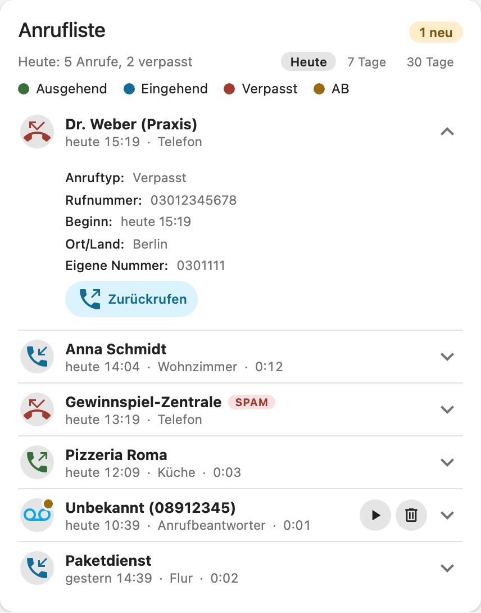
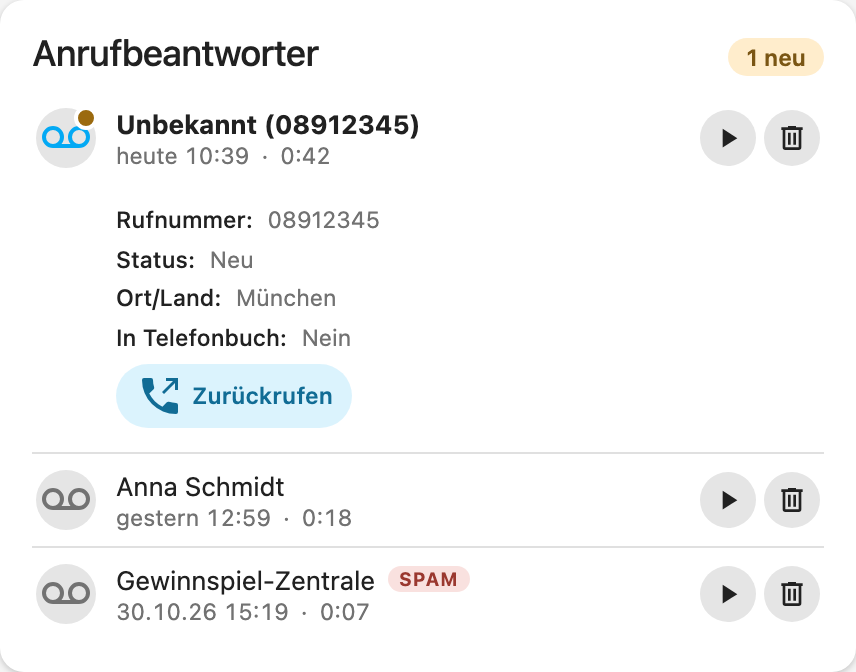

# FRITZ!Box Phone for Home Assistant – User Guide

Deutsch: [USER-GUIDE.de.md](USER-GUIDE.de.md)

[← Back to the overview](../README.en.md)

Custom Home Assistant integration for the **phonebook**, **call list**,
**answering machine** and **real-time call status** of a FRITZ!Box – via
TR-064 (`X_AVM-DE_OnTel`, `X_AVM-DE_TAM`) and the CallMonitor protocol
(port 1012).

The integration works locally with the FRITZ!Box. Only the optional
services PhoneBlock and Tellows open internet connections. The technical
basis is the [AVM interface descriptions](https://fritz.com/pages/schnittstellen)
for TR-064 (`X_AVM-DE_OnTel`, `X_AVM-DE_TAM`, `X_VoIP`).

Current integration version: **2.5.1** (see
[`manifest.json`](../custom_components/fritzbox_phone/manifest.json) and the
[changelog](../CHANGELOG.en.md)).

## Contents

- [Requirements on the FRITZ!Box](#requirements-on-the-fritzbox)
- [Supported devices](#supported-devices)
- [Installation](#installation)
- [Update](#update)
- [Removing the integration](#removing-the-integration)
- [Options](#options)
- [Spam detection (PhoneBlock)](#spam-detection-phoneblock)
- [Reverse lookup (Tellows)](#reverse-lookup-tellows)
- [Location and country detection (offline)](#location-and-country-detection-offline)
- [Entities](#entities)
- [Data updates](#data-updates)
- [Known limitations](#known-limitations)
- [Logbook and events](#logbook-and-events)
- [Actions (services)](#actions-services)
- [Call history (optional)](#call-history-optional)
- [Websocket API for panels](#websocket-api-for-panels)
- [Blueprints](#blueprints)
- [Dashboard card: fritzbox-phone-card](#dashboard-card-fritzbox-phone-card)
- [Privacy and security](#privacy-and-security)
- [Files](#files)
- [Development and tests](#development-and-tests)
- [Trademark notice](#trademark-notice)
- [Notes](#notes)
- [Troubleshooting](#troubleshooting)
- [Changelog](../CHANGELOG.en.md)

## Requirements on the FRITZ!Box

| # | What | Where |
|---|------|-------|
| 1 | Enable TR-064 | Home Network → Network → Network Settings → "Allow access for applications" |
| 2 | A dedicated FRITZ!Box user for Home Assistant | System → FRITZ!Box Users → permission "FRITZ!Box Settings" (includes access to telephony, the call list and voice messages) |
| 3 | At least one configured answering machine (only needed for the TAM sensors) | Telephony → Answering Machine |
| 4 | Enable the CallMonitor (only needed for the call monitor sensor) | dial `#96*5*` once from a connected phone (`#96*4*` disables it again) |

## Supported devices

The integration talks to any FRITZ!Box that offers TR-064 and has its
telephony features set up. It needs the following services of the box; if
one is missing, only the related entities are omitted:

| Feature | Required service of the box |
|---------|-----------------------------|
| Phonebook, call list, dialing, call barring | TR-064 `X_AVM-DE_OnTel`, `X_VoIP` |
| Answering machine | TR-064 `X_AVM-DE_TAM` |
| Call forwarding | TR-064 `X_AVM-DE_OnTel` (call forwarding) |
| Call monitor (real time) | CallMonitor on port 1012 (`#96*5*`) |

There is no list of individually tested models and FRITZ!OS versions. If
you use the integration with a specific box, feel free to report it in an
[issue](https://github.com/bertel2020/HA-fritzbox_phone/issues) so the list
here can grow. FRITZ!Repeaters and other AVM devices without telephony
features do not offer the services mentioned.

## Installation

### Via HACS (recommended)

[](https://my.home-assistant.io/redirect/hacs_repository/?owner=bertel2020&repository=HA-fritzbox_phone&category=integration)
[](https://my.home-assistant.io/redirect/config_flow_start/?domain=fritzbox_phone)

1. Use the first button to open the FRITZ!Box Phone repository in HACS.
2. Download **FRITZ!Box Phone** and restart Home Assistant.
3. Use the second button to add the integration. Alternatively, in Home
   Assistant open **Settings → Devices & services → Add integration →
   FRITZ!Box Phone**.
4. Enter host/IP, username and password (if a FRITZ!Box has been
   discovered on the network, Home Assistant suggests it automatically - then
   username and password are enough). TLS is optional; the port
   is chosen automatically based on the TLS setting, but can be
   overridden.

If the first button does not work, in HACS go to **Integrations →
Custom repositories** and add `https://github.com/bertel2020/HA-fritzbox_phone`
as category **Integration**. In both cases a working
[HACS installation](https://www.hacs.xyz/) is required.

### Manual

Copy the folder `custom_components/fritzbox_phone` from the repository
manually to `<HA configuration directory>/custom_components/fritzbox_phone/`.
Afterwards the Home Assistant configuration directory must contain this
structure:

```text
<HA configuration directory>/
└── custom_components/
    └── fritzbox_phone/
        ├── manifest.json
        ├── __init__.py
        ├── sensor.py
        └── ...
```

The target folder must be named exactly `fritzbox_phone` and `manifest.json`
must be located directly inside it. Then restart Home Assistant and set up the
integration via the second button above or under **Settings → Devices &
services → Add integration → FRITZ!Box Phone**.

On first start, Home Assistant installs the Python dependencies listed in
`manifest.json` automatically. This may require an internet connection of the
Home Assistant system once.

## Update

With a HACS installation, available updates are shown in HACS and installed
from there. With a manual installation, replace the contents of
`custom_components/fritzbox_phone/` completely with the contents of the new
version. The configuration is stored in Home Assistant and is therefore not
lost.

Then restart Home Assistant. If the dashboard card has changed: reload the
browser (the card is loaded with the integration version in its address path,
so an update fetches the new file automatically).

## Removing the integration

1. In Home Assistant, under **Settings → Devices & services**, open the
   "FRITZ!Box Phone" integration, choose the menu (⋮) on the entry and
   select **Delete**. Entities, devices, repair notices and the stored
   credentials are removed in the process. Several boxes are several entries
   and are deleted individually.
2. Adjust or delete your own automations, scripts and dashboards that use
   entities or actions of the integration. Home Assistant will show them
   as faulty afterwards.
3. With a HACS installation, remove the integration in HACS; with a manual
   installation, delete the folder `custom_components/fritzbox_phone/`.
   Then restart Home Assistant.

If the [call history](#call-history-optional) was enabled, its file in
`.storage` is removed when the entry is deleted, as are the stored results of
the online lookups.

Nothing the integration created remains on the FRITZ!Box, except for what you
entered yourself via the actions `block_number` and `add_contact` (call
barring entries and phonebook entries). You can delete the FRITZ!Box user
created for this under **System → FRITZ!Box Users**.
The CallMonitor can be disabled again with `#96*4*` from a connected phone.

## Options

Can be changed afterwards via **Settings → Devices & services → FRITZ!Box
Phone → Configure**. Host, port, TLS and credentials of the box are changed
by **Reconfigure** in the entry's menu; if the box rejects the stored
credentials, Home Assistant itself asks for new ones (reauth):

| Option | Default | Meaning |
|--------|---------|---------|
| Polling interval | 120 s | Polling cycle for phonebook/call list/answering machine |
| Call list period | 7 days | how far back `sensor.*_call_list` looks |
| Maximum number of calls | 50 | upper limit of the loaded call list |
| Keep call history on disk | 0 (off) | days (at most 365) for which the [call history](#call-history-optional) keeps calls. **Stores call data in `.storage`**, 0 deletes it |
| Enable call monitor | on | switches `sensor.*_call_monitor` completely off/on |
| Call monitor port | 1012 | CallMonitor port |
| Area code prefixes | empty | comma-separated, e.g. `+49`; overrides the country from the Home Assistant configuration. Without an entry, the country set there applies. Phone numbers are brought to E.164 (`+4930123456`) uniformly for the phonebook match, PhoneBlock and Tellows - regardless of whether the box reports them as national, international or (from your own local area) without an area code |
| Enable PhoneBlock | off | switches spam detection on/off, see below |
| PhoneBlock username / password | empty | credentials of a free account on [phoneblock.net](https://phoneblock.net). The stored password is never loaded back into the form - an empty field leaves it unchanged |
| Spam threshold | 50 % | the PhoneBlock spam probability from which `is_spam` is set |
| Enable online reverse lookup (Tellows) | off | switches name resolution of unknown numbers via Tellows on/off, see below |
| Hide names and numbers in the dashboard card | off | the card shows dots instead of names and numbers until a row is tapped (then readable for 15 seconds); intended for wall tablets. Display only: sensors, logbook and automations keep the real data. Can be overridden per card with the card option `privacy` (`auto`, `on`, `off`); the call monitor stays uncovered |
| Hide phones | none | Phones chosen here are left out of the "Phone for call backs" selection, the card dropdown, `call_phone` and `dial_phones`; `dial` with a hidden phone is rejected. Meant for FON sockets with nothing plugged in. The list shows what the box offered when it was last read; the phone chosen on the box stays visible in the selection. The handset sensors and the call list are not affected |

## Spam detection (PhoneBlock)

Optional enrichment of unknown callers with a spam assessment from
[PhoneBlock](https://phoneblock.net), disabled by default (free, open
source, a community-maintained database of spam numbers, built specifically
for FRITZ!Box use cases).

**Privacy:** The **phone number itself is not sent** to PhoneBlock. The
integration normalizes it to E.164 where possible and sends to
`GET /api/check` the SHA-1 hash of the full number plus two further SHA-1
hashes in which the last digit or the last two digits are missing
(`prefix10` and `prefix100`). These additional hashes allow PhoneBlock to
recognize number ranges. A query is made only for calls/messages that the
FRITZ!Box itself could not assign to a phonebook contact; results are cached
locally for 6 hours so as not to ask again in every polling cycle; a failure
(timeout, outage) is remembered for only 5 minutes. Several unknown numbers
are queried in parallel, and a polling cycle waits at most 20 seconds for
them (5 at startup) - whatever is still pending ends up in the cache in the
background. The cache survives a restart: the results (numbers with a rating,
without failures) are stored in `.storage` and thus in backups. If the spam
threshold or the country code changes, the stored PhoneBlock ratings are
discarded.

**Setup:**
1. Create a free account on [phoneblock.net](https://phoneblock.net).
2. Settings → Devices & services → FRITZ!Box Phone → Configure →
   enable "PhoneBlock spam detection" + enter username/password.

**What is enriched:** `sensor.*_call_list` (entries without a
phonebook name), `sensor.*_<answering_machine>` (messages without a
phonebook name) and `sensor.*_call_monitor` for incoming calls from
unknown numbers – each with `is_spam`, `spam_confidence` (0–100),
`spam_rating` (PhoneBlock classification such as `E_ADVERTISING`) and
`spam_location` (place, if known). The `fritzbox-phone-card` automatically
shows a red "Spam" badge next to the name.

This API returns **no name** for a number (only a spam rating) –
for real name resolution see [Reverse lookup (Tellows)](#reverse-lookup-tellows).

## Reverse lookup (Tellows)

Optional name resolution of unknown callers via
[Tellows](https://www.tellows.de) – a public, community-maintained
database of callers/spam, disabled by default. For this the integration uses
the endpoint `GET /basic/num/{number}?xml=1`, which is reachable without an
account.

**Privacy:** Unlike PhoneBlock spam detection, here the **phone number is
sent to Tellows in plain text** – that is the purpose of a reverse lookup and
cannot technically be avoided. That is why this option is deliberately
**separate** from the PhoneBlock option and disabled by default. A query is
made only for calls/messages without a phonebook name; results are cached
locally for 6 hours, also across a restart (failures 5 minutes, not
stored). The response is parsed with `defusedxml` and limited to 64 KB.

**Setup:** Settings → Devices & services → FRITZ!Box Phone →
Configure → "Enable online reverse lookup (Tellows)". No account
needed.

**What is enriched:** `sensor.*_call_list`, `sensor.*_<answering_machine>`
and `sensor.*_call_monitor` (for unknown incoming calls) with
`reverse_name` and `reverse_category` (e.g. "Funeral services" if Tellows
knows it). The `fritzbox-phone-card` shows `reverse_name` directly as the name
(instead of "Unknown"), with the source "Tellows (online reverse lookup)"
in the expandable details, as long as there is no phonebook name.

## Location and country detection (offline)

In addition to name resolution, every call/message can show (in the
expandable details of the `fritzbox-phone-card`, field "Location/Country") a
place such as "Berlin" or "Cologne" or, for international numbers, the
country. This **always** runs and entirely without a FritzBox or internet
query:

TR-064 offers no direct query for arbitrary phone numbers for this –
this was checked against the specifications of `X_AVM-DE_OnTel` and
`X_AVM-DE_TAM`. Instead, the integration uses
[`phonenumbers`](https://pypi.org/project/phonenumbers/) (the Python port
of Google's libphonenumber), which brings its own area code database –
exactly the kind of mapping that the FritzBox web interface itself
calculates locally. Purely local computation, no phone number leaves the
machine. For German mobile numbers this only yields "Germany"
(mobile prefixes are not tied to a region); for landline numbers
the city/region.

**Calls from your own local area:** The FRITZ!Box reports phone numbers from
its own local area code region without any area code (e.g. "954934"
instead of "07527954934") – without correction, `phonenumbers` would
interpret this wrongly or implausibly (e.g. guess a completely wrong place).
For this the integration queries the box's own area code once (and then
caches it permanently) via TR-064 (`X_VoIP` /
`X_AVM-DE_GetVoIPCommonAreaCode`) and adds it automatically when a
phone number arrives without a leading "0" or "+".

## Entities

All entities belong to one device per FRITZ!Box (with model, serial number
and firmware). Names and icons are translated (German/English).

| Entity | State | Main attributes |
|--------|-------|-----------------|
| `sensor.*_<phonebook>` (one per phonebook) | number of contacts | `contacts`: name, phone numbers incl. type, VIP flag, `has_image` |
| `sensor.*_call_list` | number of loaded calls | `calls`: type, name, numbers, date, duration, device/port, fax/answering machine flag, `has_recording`, `tam_index`/`tam_message_index` (which answering machine message the call belongs to), `area_name` (place/country, offline), PhoneBlock spam fields, `reverse_name`/`reverse_category` (Tellows, each if enabled) |
| `sensor.*_missed_calls` | number of missed calls | `calls`: missed calls only |
| `sensor.*_blocked_numbers` (only if the box offers call barring) | number of blocked numbers | `numbers`, `entries`: name and numbers of each entry. Read every 15 minutes and right after `block_number` / `unblock_number` |
| `sensor.*_call_list_<number>` (one per own number, only when the loaded calls use more than one) | number of calls of this number | `own_number`, `calls`: like the call list, but only the calls of this number (incoming: the number called, outgoing: the number used) |
| `sensor.*_calls_today` | calls of today | `incoming`, `outgoing`, `missed` |
| `sensor.*_talk_time_today` | minutes in accepted calls of today | - (the box rounds each call up to the minute) |
| `sensor.*_spam_calls_today` | calls of today that PhoneBlock rated as spam (only with PhoneBlock enabled) | - |
| `sensor.*_spam_calls_detected` | running counter of newly detected spam calls for long-term statistics (only with PhoneBlock enabled, survives restarts) | - |
| `sensor.*_<answering_machine>` (one per TAM) | number of new messages | `tam_index`, `mode`, `ring_seconds` (when the box answers), `phone_numbers` (the own numbers it answers for), `stick` (where it stores), `messages`: caller, date, duration, read/new, `has_recording`, `recording_path`, `area_name` (place/country, offline), PhoneBlock spam fields, `reverse_name`/`reverse_category` (Tellows, each if enabled) |
| `switch.*_<answering_machine>_active` | on/off | – |
| `switch.*_forwarding_to_<target>` (one per call forwarding of the box) | on/off; switches the call forwarding on or off | `deflection_id`, `type`, `number`, `to_number`, `mode`, `outgoing`, `phonebook_id` |
| `switch.*_alarm_clock_<name>` (one per alarm clock of the box, **disabled by default**: enable it under Settings → Entities) | on/off; switches the alarm clock on or off | `alarm_clock_index`, `time`, `weekdays`, `phone_name`. Time, days and phone cannot be changed through the box's interface, only on the box |
| `binary_sensor.*_line_<number>` (one per phone number of the box) | on as long as the provider has the number registered | `number`, `status` (message from the box, e.g. `Registered`; some boxes report a number, `2` means registered) |
| `binary_sensor.*_handset_<name>` (one per DECT handset; FRITZ!DECT sockets and other smart home devices do not count) | on as long as the handset is switched on and in range | `name`, `model`. FON sockets and IP phones report no such status to the box and so have no sensor |
| `select.*_phone_for_call_backs` (category Configuration) | the phone the dialing aid rings first (`unknown` as long as none is chosen on the box) | `options`: the phones from `dial_phones`. A choice sets the same as Telephony → Telephony Devices on the box |
| `sensor.*_phones` (category Diagnostic) | number of phones that the dialing aid can ring | `dial_phones` (valid values for the `phone` field of `dial`, such as `FON1: Telefon` or `DECT: Mobilteil 1`), `dial_phone` (currently selected on the box), `dect` (`id`, name, model, active; real handsets only), `ip` (name, number, `internal_number`, `incoming_numbers`: the own numbers the phone rings for, empty means all). Read at most once per hour |
| `binary_sensor.*_unread_messages` | on as long as any answering machine has unheard messages | `count` |
| `sensor.*_call_monitor` | `idle` / `ringing` / `dialing` / `talking`; `unavailable` as long as the connection to the CallMonitor is not up | depending on the state `from`/`to`/`with`, `from_name`/`to_name`/`with_name`, `vip`, `area_name` (place/country, offline), `device`, `phone` (the phone that picked up or places the call; FON sockets, DECT handsets and IP phones are recognised), `duration`, for unknown incoming calls additionally PhoneBlock spam fields and `reverse_name`/`reverse_category` (Tellows, each if enabled); in state `idle` the fields of the most recently ended call are kept, supplemented by `initiated` (start of ringing/dialing), `accepted` (time of acceptance), `started` (start of the call = `accepted`, if present), `closed` (hang-up), `duration_formatted` (exact call duration incl. seconds, e.g. `1:09:18`) and `ring_duration_formatted` (ring time until acceptance, e.g. `0:11`, only if the call was accepted) |
| `binary_sensor.*_ringing` | on as long as a call is ringing | `number`, `name`, `is_spam` |
| `event.*_call` | last call event | event type `ringing` / `dialing` / `talking` / `ended` / `updated`; attributes like the event `fritzbox_phone_call` |
| Sensors "PhoneBlock" and "Online reverse lookup" (category Diagnostic, disabled by default, only with the service enabled) | `ok` / `error` / `unknown`: `error` after three failed queries in a row (e.g. rejected PhoneBlock credentials), `unknown` as long as no query has succeeded yet | `consecutive_failures`, `last_success`, `last_error` (error type only, e.g. `ClientResponseError 401`). Updates with every poll of the box. On an outage the integration writes a warning to the log once; if PhoneBlock rejects the login, a notice additionally appears under Settings → Repairs |

New phonebooks and answering machines appear automatically (a
phonebook after 15 minutes at the latest, see below); if one disappears,
the entity remains as "unavailable" and can be deleted in the
UI.

The list attributes (`calls`, `contacts`, `messages`) are **not stored in the
database (recorder)** - they would exceed its per-state size limit. The
history is provided by the logbook events. The phonebook is only reloaded
from the box every 15 minutes, the call list and answering machine in
every polling cycle.

The call monitor keeps a persistent socket connection to the
CallMonitor (port 1012) and updates in real time, independently of the
polling interval of the other sensors – states and attribute schema
correspond to the core sensor `fritzbox_callmonitor`, but it uses
the already configured credentials and phonebooks of this
integration instead of a config entry of its own.

**Ringing appears immediately.** The state `ringing` is set as soon as
the box reports the call; spam check and reverse lookup run afterwards and
follow as a second event (`enriched: true`, in the logbook "Caller identified
in more detail"). Several simultaneous calls (call waiting) are
tracked separately: the most important ongoing one is shown (call before
ringing before dialing); after a call is hung up, a call that is still
ringing remains visible. If the box refuses the connection (CallMonitor not
enabled, restart), the integration retries at growing intervals
(30 s to 5 min) instead of giving up. After three failed attempts in a row,
a notice about `#96*5*` appears under Settings → Repairs; it
disappears as soon as the connection is up.

## Data updates

| Data | How it stays current |
|------|----------------------|
| Call list, answering machine, call forwarding, statistics | Query of the box at the polling interval (default 120 s, adjustable under Options) |
| Phonebook | Reload every 15 minutes, independent of the polling interval |
| Call monitor, ringing, event "Call" | Push: persistent socket connection to the CallMonitor (port 1012), state changes arrive immediately, without waiting for the next poll |
| Phones (dialing aid, DECT, IP phones) | At most once per hour; right away after a change with the selection "Phone for call backs" |
| PhoneBlock / reverse lookup status | With every poll of the box |

If you switch an answering machine or a call forwarding, the box is
queried again immediately afterwards. If the box is unreachable, the
entities become "unavailable"; the integration reports this once in the log
and once when it comes back. If the CallMonitor connection drops, it is
re-established at growing intervals (30 s to 5 min).

## Known limitations

- **Single phones** cannot be rung by the box without a far end: `call_phone` calls
  through the dialing aid, and the phone chosen there rings first. FON sockets and
  IP phones have no status sensor of their own, and the phone of a call (`phone`)
  is derived from the box's numbering.
- **The ringer lock** of the box is not reachable via its interface and is
  therefore not included as a switch.
- **The call monitor** only works as long as the CallMonitor is enabled on
  the box (`#96*5*`); the connection is unencrypted and intended for the
  local network only.
- **The box rounds** the call duration in the call list up to the minute;
  second-level precision is only provided by the call monitor.
- **The phonebook** is only loaded every 15 minutes; a new contact in
  the box is therefore only visible after that.
- **Disappeared phonebooks or answering machines** remain as "unavailable"
  and must be deleted in the UI.
- **The status sensors** for PhoneBlock and reverse lookup are disabled by
  default on new installations (Settings → Devices & services →
  Entities → "Show disabled entities"). An outage also appears as a
  repair notice and in the log.
- **The library `fritzconnection`** works synchronously and therefore runs in
  the background thread of Home Assistant; barring, dialing and
  switching actions are executed one after another.
- **Online services** (PhoneBlock, Tellows) depend on their availability and
  request limits; without them the rest remains fully functional.

## Logbook and events

In the activity dialog of an entity, Home Assistant shows the reason for a
state change under **"What happened"**. So that it does not say "No reason
was recorded for this activity" there, the integration fires an event for
every notable change and writes the new state in the same context – the
logbook turns this into plain text:

| Entity | Example for "What happened" |
|--------|-----------------------------|
| `sensor.*_call_monitor` | Incoming call from Max Mustermann (+49301234567) |
| | Outgoing call to Max Mustermann (+49301234567) via DECT1 |
| | Call with Max Mustermann (+49301234567) accepted (after 0:12 ringing) |
| | Call with Max Mustermann (+49301234567) ended after 2:31 |
| | Call from +49309999999 (Berlin) not accepted – classified as spam (confidence 95 %) |
| `sensor.*_call_list` | New entry: Outgoing call to Max Mustermann (+49301234567) |
| | 2 entries no longer in the call list (outside the time window or deleted on the FRITZ!Box) |
| `sensor.*_missed_calls` | Missed call from +49309999999 (Berlin) at 16:10 |
| `sensor.*_<answering_machine>` | New message from Max Mustermann (+49301234567), duration 0:42 |

The events can also be used directly as automation triggers:

| Event | When | Usable fields |
|-------|------|---------------|
| `fritzbox_phone_call` | every change of the call monitor; additionally a follow-up event when spam check/reverse lookup deliver a result only later | `call_state` (`ringing`/`dialing`/`talking`/`idle`), `direction`, `number`, `name`, `reverse_name`, `device`, `vip`, `is_spam`, `spam_confidence`, `answered`, `duration_formatted`, `ring_duration_formatted`, `enriched` (`true` for the follow-up event) |
| `fritzbox_phone_call_list_changed` | new or dropped entries of the call list | `added` (list), `added_count`, `removed` |
| `fritzbox_phone_missed_call` | new or dropped missed calls | `added` (list), `added_count`, `removed` |
| `fritzbox_phone_tam_message` | new or read/deleted answering machine messages | `tam_index`, `tam_name`, `added` (list), `added_count`, `removed` |

For automations in the editor, the entities `event.*_call` and `binary_sensor.*_ringing` are also suitable. Each event additionally contains `config_entry_id` and `host`, to be able to filter when there are several
FRITZ!Boxes. Example:

```yaml
triggers:
  - trigger: event
    event_type: fritzbox_phone_call
    event_data:
      call_state: ringing
      is_spam: true
actions:
  - action: notify.persistent_notification
    data:
      message: "Spam call from {{ trigger.event.data.number }}"
```

> The events deliberately carry **no** `entity_id`: Home Assistant would
> otherwise list them additionally as a separate row in the entity's activity
> list – that is, duplicating the state change they already explain.

## Actions (services)

| Action | Purpose | Target / fields |
|---------|---------|--------|
| `fritzbox_phone.mark_message_read` | Mark an answering machine message as (un)read | `sensor.*_<answering_machine>`; `message_index`, `read` |
| `fritzbox_phone.delete_message` | Delete a message on the box | `sensor.*_<answering_machine>`; `message_index` |
| `fritzbox_phone.play_message` | Play an answering machine recording on a media player (signed address, valid for ten minutes; the speaker must be able to reach Home Assistant at the internal address) | Entity: answering machine sensor; `message_index`, `media_player`, optional `message_key` |
| `fritzbox_phone.dial` | Start a call via the box's dialing aid: the phone selected there rings first, the number is dialed after pickup | Device (optional with only one box); `number`, optional `phone` (ring this phone for this call instead of the one selected on the box; afterwards the integration restores the box's selection), optional `max_ring_seconds` (1–300: hangs up after this time if nobody picked up) |
| `fritzbox_phone.turn_on_for` | Switch an answering machine or call forwarding on for a while and then off again. The timer is stored and survives a restart; switching off by hand cancels it | Entity: switch of the answering machine or call forwarding; `minutes` (1–1440) |
| `fritzbox_phone.call_phone` | Call one of the box's phones internally: the dialing aid phone rings first, and the target phone once you pick up. A single phone cannot be rung without a far end | Device (optional); `target_phone` (a name from the "Phones" sensor, e.g. `Mobilteil 1`, `FRITZ!App Fon` or `FON1: Telefon`), optional `phone` and `max_ring_seconds` as with `dial` |
| `fritzbox_phone.probe_phones` | Responds with the box's raw answers to the phone requests (dialing aid, phone ports, IP phones, DECT handsets), without passwords or SIP credentials. For diagnosis | Device (optional) |
| `fritzbox_phone.hangup` | Cancel a dialing process that has not yet been accepted | Device (optional) |
| `fritzbox_phone.lookup_number` | Responds with what is known about a number | Device (optional); `number` |
| `fritzbox_phone.add_contact` | Create a contact in a phonebook of the box, with one or more numbers (each with a type), e-mail addresses and VIP flag. Numbers that are already in a phonebook (also in a different spelling) are rejected | Device (optional); `name`, `number` or `numbers` (list of `number` and `type`: `home`, `mobile`, `work`, `fax_work`, `other`), optional `emails` (list), `vip` (default off), `phonebook_id` (default 0 = first phonebook; the number is available as the attribute `phonebook_id` on the phonebook sensor and as `id` in the websocket command `fritzbox_phone/phonebooks`) |
| `fritzbox_phone.update_contact` | Change name, numbers, e-mail addresses and VIP flag of a contact. The entry is read from the box, only these parts are replaced (the given numbers and e-mail addresses are afterwards the complete list) and written back with its identifier, as AVM prescribes; everything else (image, speed dial, door intercom) is kept. If the box responds with a different identifier, it either replaces the entry (the old identifier is gone) or has created a second one; in that case the old one is deleted, and if that fails, the new one | Device (optional); `contact_id`, `name`, `numbers`, optional `emails`, `vip`, `phonebook_id`. Administrators only (automations without a user are allowed) |
| `fritzbox_phone.delete_contact` | Delete a contact from a phonebook of the box (cannot be undone) | Device (optional); `contact_id`, optional `phonebook_id`. Administrators only (automations without a user are allowed) |
| `fritzbox_phone.add_number_to_contact` | Adds a further number to a contact that is already in the phonebook (for example a landline to a saved mobile number). The entry is read from the box, the number is added and it is written back with its identifier. E-mail, image, VIP flag and the other numbers are kept. If the box responds with a different identifier, the same applies as for `update_contact`. Numbers that are already in a phonebook are rejected | Device (optional); `contact_id` (`uniqueid` of the contact, see the attribute `contacts` and the websocket command `contacts`), `number`, optional `number_type` (`home`, `mobile`, `work`, `fax_work`, `other`; default `home`), optional `phonebook_id` (default 0) |
| `fritzbox_phone.block_number` | Add a number to the box's call barring: calls from it are rejected by the box. If it is already there, nothing happens | Device (optional); `number`, optional `name` (label in the block list) |
| `fritzbox_phone.unblock_number` | Remove a number from the call barring; reports an error if it was not blocked | Device (optional); `number` |

The dialing aid must be enabled on the FRITZ!Box (Telephony →
Telephony Devices). `dial` accepts only digits and the characters `+ * # ( ) - /`
as well as spaces.

`message_index` is listed as `index` in the attribute `messages` of the
respective sensor. When called on a different entity, the answering machine
actions respond with an error message. Examples:

```yaml
action: fritzbox_phone.mark_message_read
target:
  entity_id: sensor.YOUR_ANSWERING_MACHINE
data:
  message_index: 3
  read: true
```

```yaml
# Call back from an automation
action: fritzbox_phone.dial
data:
  number: "030 123456"
```

```yaml
# What does the integration know about this number?
action: fritzbox_phone.lookup_number
data:
  number: "+49 30 123456"
response_variable: info
# info.contact.name, info.area_name, info.spam.confidence, info.reverse_lookup.name
```

`delete_message` deletes the chosen message on the FRITZ!Box. Before using it
in automations, you should therefore check that the target entity and
the message index really match.

## Dashboard card: fritzbox-phone-card

<p align="center">
  
  
</p>

The integration ships its own native Lovelace card as a JS resource
(`www/fritzbox-phone-card.js`, served automatically during setup at
`/fritzbox_phone_static/fritzbox-phone-card.js`). Based on the entity, it
automatically detects whether it is a call list
(`calls` attribute), an answering machine (`messages` attribute) or the
call monitor (state `idle`/`ringing`/`dialing`/`talking`), and
renders the matching view. Call list and answering machine share
the same row layout (icon | name + date [· end device only for the
call list] · duration | optionally play/delete). For unknown callers,
the phone number appears in parentheses after "Unknown" (e.g. "Unknown
(030123456)"); if a name is known, the phone number is only shown in the
expandable details of a row. The card plays recordings **authenticated**: the integration streams them
via `/api/fritzbox_phone/recording/...` directly from the box (the
session identifier of the box never leaves the integration), and the card obtains
a short-lived signed address from Home Assistant for this. During playback,
expanded rows, legend filters and an open delete confirmation
are preserved - even when Home Assistant delivers new states.

**Active call:** If the card points to `sensor.*_call_monitor`, it renders
a single, prominently highlighted row with the currently
ongoing call instead of a list – name/number (incl. VIP and spam badge, Tellows name for
unknown callers), state ("Ringing"/"Dialing"/"Talking", colored
differently, icon pulses while "Ringing") as well as place/country and a running
time since ringing/dialing/call start (updates itself every
second, independently of the polling interval, since the call monitor receives events
in real time over its own CallMonitor connection). If no call is
active, it shows "No active call" plus – if available – a row
for the most recently ended call: name/number, start–end (e.g.
"16:17–17:26"), place/country and the exact call duration incl. seconds
(e.g. "1:09:18" instead of the duration from the call list rounded to
minutes).

**Integrating the answering machine into the call list:** With the optional
option `tam_entity`, an answering machine sensor can be linked to the
call list – **not** as an additional list, but directly within the
respective row: A call that went to the answering machine
gets, in addition to the expand arrow, play/delete buttons (incl.
a progress bar during playback), a voicemail icon and a
"New" dot for unheard messages – the two events (call and
answering machine message) merge into a single row this way, without
losing the expandable details. The legend gets an additional filter "TAM"
for this (its own category, analogous to "Missed"), and the
card header shows the same "X new" pill as the standalone
answering machine card (counts all new messages of the linked
entity, not only those visible in the call list).

The match is made preferably via the recording file that call and
message both point to (`tam_message_index` in the call). If it is missing, the
card falls back to the phone number (tolerating national/international
spellings such as `030123456` vs. `+4930123456`) and, if several
messages of the same number come into question, the closest
timestamp in time. Messages without a
matching entry in the call list (limited by time/quantity) do not
appear here – for those, the standalone
answering machine card (`entity` set directly to the answering machine sensor,
without `tam_entity`) remains fully usable, incl. all
messages regardless of the call list period.

**No setup needed:** The integration registers the card with Home Assistant
itself at startup (also for YAML dashboards). A resource entered by hand
earlier (`/fritzbox_phone_static/fritzbox-phone-card.js`,
type `module`) can stay or be removed.

Add the card via **"Add card" → "FRITZ!Box Call list /
Answering machine / Phonebook / Call monitor"** with the graphical editor
(it shows only the options that match the chosen entity), or
directly via YAML:

```yaml
type: custom:fritzbox-phone-card
entity: sensor.YOUR_FRITZBOX_CALL_LIST
rows: 8
```

```yaml
# Call list + answering machine in one card
type: custom:fritzbox-phone-card
entity: sensor.YOUR_FRITZBOX_CALL_LIST
tam_entity: sensor.YOUR_ANSWERING_MACHINE
rows: 8
```

```yaml
type: custom:fritzbox-phone-card
entity: sensor.YOUR_ANSWERING_MACHINE
rows: 8
mark_read_on_play: true
```

```yaml
type: custom:fritzbox-phone-card
entity: sensor.YOUR_CALL_MONITOR
```

```yaml
# Phonebook with search
type: custom:fritzbox-phone-card
entity: sensor.YOUR_PHONEBOOK
rows: 10
```

The card follows the Home Assistant language (German or English), can be
operated by keyboard (Enter/Space expands rows) and reports
errors as a Home Assistant notice instead of a dialog.

| Option | Default | Meaning |
|--------|---------|---------|
| `entity` | – (required) | `sensor.*_call_list`, `sensor.*_<answering_machine>`, `sensor.*_<phonebook>` or `sensor.*_call_monitor` |
| `title` | name of the entity | Override the card title |
| `rows` | 8 | Call list/answering machine/phonebook: maximum number of displayed rows |
| `show_legend` | on | Call list only: colored legend (Outgoing/Incoming/Missed) above the list |
| `tam_entity` | – (optional) | Call list only: linked `sensor.*_<answering_machine>` - calls that went there get play/delete directly in their row |
| `show_stats` | on | Call list only: summary "Today: x calls, y missed" with a switch to 7 or 30 days (then with one bar per day) |
| `show_dial` | on | Call list, answering machine, phonebook: "Call back" buttons, in the phonebook "Call" (via `fritzbox_phone.dial`) |
| `dial_phone` | – (optional) | Which phone rings for a call back (a name from `dial_phones` of the phones sensor); without one the phone set on the box rings. Offered in the editor when the phones sensor lists phones |
| `show_manage` | off | Call list, answering machine: buttons "Block" (with confirmation, via `fritzbox_phone.block_number`) and "Add to phonebook" (asks for the name, via `fritzbox_phone.add_contact`; only for callers without a name) |
| `tap_action` | `expand` | Call list/answering machine: tapping a row expands details (`expand`) or opens the entity (`more-info`) |
| `mark_read_on_play` | on | Answering machine only (also as `tam_entity`): automatically mark the message as read when played |

The legend is clickable: a click on an entry hides all calls
of this type from the list (click again to show them again) – a purely
client-side filter, not stored in the card configuration.
`rows` refers to the *visible* entries: hidden
rows are filled up by matching calls further down,
so that up to `rows` rows remain visible (instead of simply showing
fewer).

A click on a row (for answering machine messages: on the name/
meta line, not on play/delete) expands further details –
among them the phone number, place/country (determined offline, see below), for
calls additionally the call type, start, end and duration of the call as well as
the fax/answering machine flag, for messages the status and whether the number is in the
phonebook. Start/end are shown to the minute (the
FRITZ!Box itself supplies both the call time and the duration only
to the minute – the duration in the format `hh:mm`, rounded up; the end is
calculated from it).

## Call history (optional)

The FRITZ!Box keeps only a limited call list, and the integration queries
only the window from the options (default 7 days, 50 calls) from it. For
statistics over weeks or a year, the integration can keep the calls
itself: option **Keep call history on disk**
(days, 0 = off, at most 365).

- **Off by default.** Then nothing is stored; a file from an
  earlier setting is deleted at the next start of the entry.
- **When enabled**, every newly read call list is added to the
  history. The same call counts only once (stable call ID, see
  below); later spam or name data replace the old ones. Calls that are
  older than the configured number of days are removed.
- **Stored** per entry in
  `.storage/fritzbox_phone.call_history.<entry_id>`, with phone numbers, names
  and times. The file thus also ends up in the Home Assistant backups.
  Anyone who can see the disks or backups can see these calls.
- **Read** the history is only by the websocket commands
  `fritzbox_phone/calls` and `fritzbox_phone/stats` (below). Sensors, card
  and logbook remain unchanged.
- When the entry is deleted, the file is removed. Shortening the
  period takes effect at the next start of the entry (saving the options reloads
  it).

## Websocket API for panels

For panels (such as the "Box > Phone" page of the integration
`fritzbox_network`) there are websocket commands that do not depend on entity
IDs or attribute names. New fields may be added; existing ones
are not renamed.

- **Administrators only** (`unauthorized` otherwise). The responses contain
  the real names and numbers; `privacy_mode` passes on the option "Hide names
  and numbers" so that the panel obeys it like the card does.
- **Errors:** `not_found` for an unknown or not loaded entry
  (for `contacts` also for an unknown phonebook), `box_request_failed`
  if the box does not respond. No numbers or names end up in the log.
- **Times:** `datetime`, `oldest`, `newest` are ISO 8601 with the
  time offset of the Home Assistant time zone
  (`2026-01-10T09:15:00+01:00`), `date` in `per_day` is `YYYY-MM-DD`.
  Durations are minutes; the box supplies them as `h:mm` and rounds up.

| Command | Fields | Response |
|---------|--------|----------|
| `fritzbox_phone/entries` | – | `entries`: per entry `entry_id`, `title`, `host`, `serial` (serial number of the box or `null`), `loaded`, `call_list_days`, `call_list_max`, `privacy_mode`, `history_days` (0 = history off), `version` |
| `fritzbox_phone/phonebooks` | `entry_id` | `phonebooks`: `id` (for `add_contact` as `phonebook_id`), `name`, `count` |
| `fritzbox_phone/contacts` | `entry_id`, `phonebook_id`, optional `query` (part of the name or digits of the number) | `contacts`: `uniqueid`, `name`, `vip`, `has_image`, `numbers` (`number`, `type`); `privacy_mode` |
| `fritzbox_phone/calls` | `entry_id`, optional `days`, `limit` (both default: call list window of the options, 0 = no limit), `offset` | `calls` (newest first), `window` (`days`, `max`, `offset`, `oldest`, `source`: `list` or `history`), `total` (number in the period before paging), `privacy_mode` |
| `fritzbox_phone/tams` | `entry_id` | `tams`: `index`, `name`, `enabled`, `running`, `capacity_minutes_remaining`, `new_count`, `total`, `messages` |
| `fritzbox_phone/blocklist` | `entry_id` | `numbers` (call barring of the box, read fresh on every call), `entries` (`uniqueid`, `name`, `numbers`), `supported`; without call barring (box or user without the feature) `numbers: []`, `supported: false` |
| `fritzbox_phone/stats` | `entry_id`, `days` (`7`, `30`, `90`, `365`, `0` = everything available) | `window`, `per_day`, `heat`, `totals`, `previous`, `compare`, `top_callers`, `top_called`, `per_line` |

**Calls** have the fields of the attribute `calls` of the call list sensor
and additionally: `id` (stable call ID), `box_id` (running number of the box, formerly
`id`), `datetime`, `vip` (from the phonebook) and `in_list` (still in the
call list of the box). A recording can only be played when `in_list: true`;
for older entries from the history, `has_recording` is false.

**Source of the calls:** Without history, the current call list always answers.
With history, `calls` answers from the history if `days` is 0 or greater
than the call list period; `stats` with history always calculates from the
history. `window.source` tells which source it was.

**Stable call ID:** a hash of the number the box gives the entry
and the start time. It stays the same across polls and restarts, even when an
ongoing call (`active_*`) becomes the finished entry, and does not collide
when the box starts counting anew after its list was deleted. Entries without
a number from the box are hashed over time, numbers, duration and type. Messages
on the answering machine also have a stable `id` (from answering machine,
time and number, like `key`) and additionally `tam_index`; `index` remains the
number of the message on the box.

**Statistics:** Days are calendar days in the Home Assistant time zone,
including today.

- `window`: `days`, `from`, `to` (days), `oldest`, `newest` (oldest and
  newest available call of the source), `count` (calls in the period),
  `undated` (calls without a readable date, not counted), `source`.
- `per_day`: per day `date`, `incoming`, `outgoing`, `missed`, `spam`,
  `talk_minutes`. Each call counts in exactly one series: spam before
  outgoing before missed (missed, rejected or accepted by the answering machine)
  before incoming.
- `heat`: 7 × 24 counts, weekday (Monday first) × hour.
- `totals`: `calls`, `incoming`, `outgoing`, `missed`, `spam`, `connected`,
  `talk_minutes`, `avg_talk_minutes` (per connected call, i.e.
  incoming or outgoing and not the answering machine), `missed_rate`
  (missed per arriving call, 0 to 1).
- `previous`: the same totals for the period of equal length before it, or
  `null`. `compare` says how far back the data reaches: `kind` `full`,
  `partial` (at least half of the preceding period is covered,
  `cover_days` days) or `none`; with `days: 0` always `none`.
- `top_callers` / `top_called`: the five most frequent numbers incoming or
  outgoing, with `number`, `name`, `vip`, `count`, `talk_minutes`, `spam`.
- `per_line`: calls per own number (`own_number`, `count`).

Example (developer tools or a panel of your own):

```js
const { entries } = await hass.callWS({ type: "fritzbox_phone/entries" });
const stats = await hass.callWS({
  type: "fritzbox_phone/stats",
  entry_id: entries[0].entry_id,
  days: 30,
});
```

A panel plays recordings just like the card: sign the `recording_path` of a
message with `auth/sign_path` and load the signed address.

In addition, the entities now carry what a panel needs for mapping:
`call_list_days`, `call_list_max` and `call_history_days` on the
call list sensor, `phonebook_id` on every phonebook sensor and
`tam_index` on the answering machine switch (the sensor already had it).

## Blueprints

The folder [`blueprints/automation/fritzbox_phone/`](blueprints/automation/fritzbox_phone)
contains six ready-made automation templates. Home Assistant does not load
them by itself; copy the files to `<configuration>/blueprints/automation/fritzbox_phone/`
or, under **Settings → Automations & scenes → Blueprints →
Import blueprint**, enter the address of the file on GitHub:

| Blueprint | Purpose |
|-----------|---------|
| `notify_missed_call.yaml` | runs an action for every new missed call (e.g. push notification); `caller`, `place`, `is_spam` are available in the action; spam can be hidden |
| `spam_call_alert.yaml` | warns as soon as a ringing call has been classified as spam by PhoneBlock (from an adjustable probability); `number`, `name`, `confidence` are available |
| `notify_ringing.yaml` | runs an action when ringing (once per call, even if the name or spam check arrives later) and optionally pauses media players; `caller`, `number`, `is_vip`, `is_spam` are available |
| `vip_call.yaml` | runs an action when a contact marked as VIP calls, e.g. a notification that breaks through "Do not disturb"; `caller`, `number` are available |
| `scheduled_forwarding.yaml` | switches a call forwarding on at one time and off at another, on selectable weekdays (e.g. "to the mobile at night") |
| `notify_tam_message.yaml` | runs an action for every new message on the answering machine; `caller`, `place`, `duration`, `tam_name`, `is_spam` are available; spam can be hidden |

## Privacy and security

- **Where phone numbers show up:** in the attributes of the sensors (not in
  the recorder, see above), in the events and in the logbook (the logbook is
  in the recorder). The diagnostics data contain only counters.
- **What reaches the internet:** nothing as long as PhoneBlock and Tellows are
  off. PhoneBlock receives only SHA-1 hashes, Tellows the phone number in
  plain text (see above).
- **TLS to the box:** The encrypted connection (TLS) does **not** verify the
  certificate of the FRITZ!Box (the library `fritzconnection` sets
  `verify=False` because the box uses a self-signed certificate). It
  protects against eavesdropping, not against an attacker who impersonates the
  box on the local network. The CallMonitor (port 1012) is unencrypted.
- **Session identifier of the box:** The download addresses of the box contain
  a valid session identifier (`sid=`). It appears neither in entity attributes nor
  in the database; recordings are served via the authenticated Home Assistant address.
- **Call history:** only if enabled (default off); then calls
  with numbers and names are stored in `.storage` and in the backups, see
  [Call history](#call-history-optional). The websocket commands give out
  numbers only to administrators.
- **Access rights:** Every logged-in Home Assistant user who sees the
  answering machine sensors can play the recordings.
  Keep that in mind for user permissions and backups.
- **The FRITZ!Box user** needs the permission "FRITZ!Box Settings";
  a dedicated user only for Home Assistant limits the damage if the
  password gets lost.

## Files

The integration files are located in the repository under
`custom_components/fritzbox_phone/`.

| Path | Content |
|------|---------|
| `api.py` | TR-064 client (phonebook, call list, answering machine, dialing aid) |
| `callmonitor.py` | CallMonitor (port 1012): connection, state per call, real-time call status |
| `coordinator.py` | Polling coordinator, contact index, online enrichment |
| `phone_numbers.py` | uniform phone number normalization (E.164) |
| `phoneblock.py` / `tellows.py` / `cache.py` | Clients for the optional spam detection and reverse lookup, shared cache |
| `geocoding.py` | Offline location/country detection (`phonenumbers`) |
| `config_flow.py` | Setup, discovery (SSDP), re-authentication, reconfiguration, options |
| `views.py` | authenticated delivery of the answering machine recordings |
| `services.py` / `services.yaml` | Actions |
| `websocket.py` | Websocket commands for panels |
| `history.py` / `payloads.py` | optional call history and statistics / shared shape of calls, messages and contacts |
| `logbook.py` | Plain-text explanations in the logbook ("What happened") |
| `sensor.py` / `binary_sensor.py` / `event.py` / `switch.py` | Entities |
| `diagnostics.py` | Diagnostics data without credentials and phone numbers |
| `strings.json`, `translations/`, `icons.json` | Texts (English as the base, German) and icons |
| `www/fritzbox-phone-card.js` | Lovelace card (call list, answering machine, phonebook, call monitor) |
| `brand/` | FRITZ! logo and square icon for the device page and integration overview |
| `hacs.json` | Metadata for installation as a custom HACS repository |

## Trademark notice

The integration contains the FRITZ! brand logo and a square variant
in the local `custom_components/fritzbox_phone/brand/` directory
supported by Home Assistant. The trademark rights
remain with FRITZ! GmbH.

> **Trademark notice:** This project is an independent, unofficial
> integration and is not affiliated with FRITZ! GmbH. FRITZ!,
> FRITZ!Box and FRITZ!OS as well as the associated logos are protected
> trademarks of their respective owners. The trademarks and brand images are not
> part of this project's open source license.

## Notes

- Dependency: [`fritzconnection`](https://github.com/kbr/fritzconnection)
  (installed automatically by Home Assistant; the core integrations `fritz`
  and `fritzbox_callmonitor` use the same library).
- For TR-064 the integration uses either HTTP or HTTPS. The
  CallMonitor itself is a separate, unencrypted TCP protocol on the
  local network (port 1012 by default).
- Phonebook contacts, call lists and answering machine messages become
  visible as entity attributes in Home Assistant (see
  [Privacy and security](#privacy-and-security)).
- A polling cycle no longer waits for slow online services:
  PhoneBlock and Tellows run in parallel and with a time limit.
- According to the AVM specification, `New=0` in the
  answering machine message list means "new/unread" – this is inverted
  accordingly in `api.py` so that the sensor state intuitively shows "number of new
  messages".

## Troubleshooting

| Problem | Check |
|---------|-------|
| Integration is not found | Target folder is named exactly `custom_components/fritzbox_phone`; `manifest.json` is located directly inside it; Home Assistant was restarted |
| Connection or login fails | Host/IP reachable, TR-064 enabled, dedicated FRITZ!Box user and matching permission, password correct; with TLS/a different port, check the entries |
| Call monitor stays without events | Dial `#96*5*` on a phone connected to the FRITZ!Box; port 1012 reachable between Home Assistant and the FRITZ!Box; option "Enable call monitor" switched on |
| New phonebook is missing | Phonebooks are reloaded every 15 minutes; a new one then appears by itself |
| Login is rejected ("Re-authenticate" notice) | Password or user changed? Follow the notice and enter new credentials |
| Call monitor "unavailable" | Enable the CallMonitor via `#96*5*`; the integration retries every 30 s to 5 min (message in the log) |
| A phone is missing or shown wrongly | A read error leaves one warning in the log (e.g. `Telefone konnten nicht gelesen werden`). Run `fritzbox_phone.probe_phones` under Developer tools → Actions with the response and compare the raw data with the "Phones" sensor |
| "Call back" does nothing | Enable the box's dialing aid (Telephony → Telephony Devices) and check that the user has the permission "FRITZ!Box Settings" |
| Recording cannot be played | The message may have been deleted on the box or has no recording; note the message in the card or in the log |
| Card does not appear in the card dialog | Integration loaded? Browser reloaded (Ctrl+F5)? An old resource entered by hand can be removed |
| Card shows old content after an update | Hard-reload the browser (Ctrl+F5) |

For detailed messages, search for `fritzbox_phone` under
**Settings → System → Logs**.

## Development and tests

```bash
pip install -r requirements_test.txt
ruff check custom_components tests
pytest                                # integration (pytest-homeassistant-custom-component)

cd tests/card && npm ci && npm test   # card in a simulated browser (jsdom)
```

The GitHub Action `Tests` runs both on every push; `Hassfest` and
`HACS` check the metadata.

---

Copyright © 2026 bertel2020

The source code is licensed under the [MIT License](../LICENSE). Excluded are the
trademarks and brand images named in the [Trademark notice](#trademark-notice).
